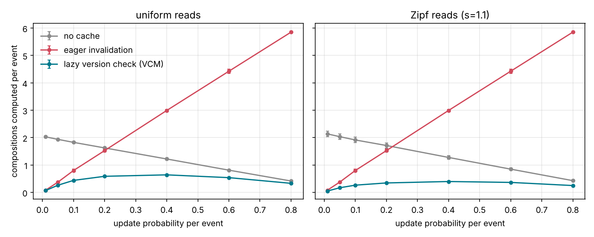
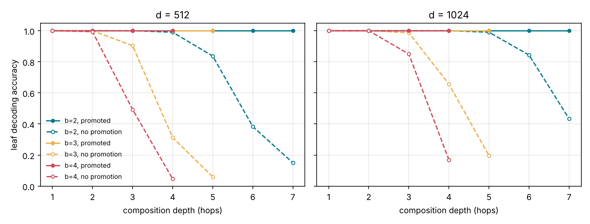
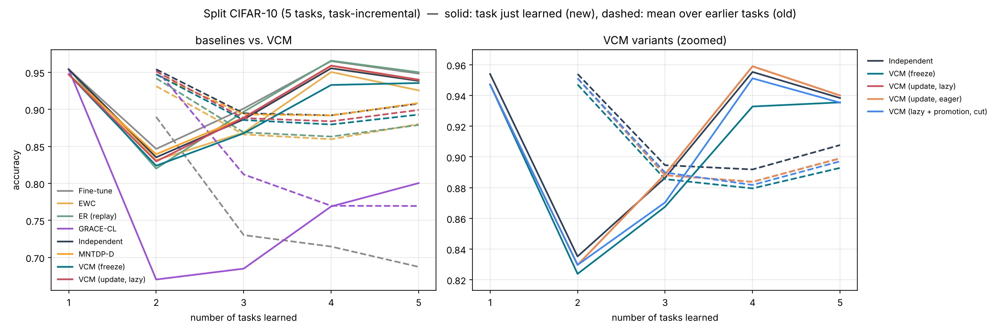
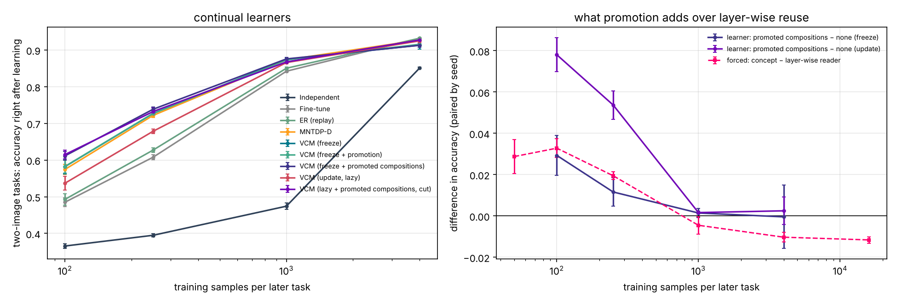
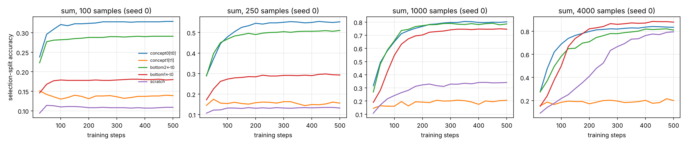
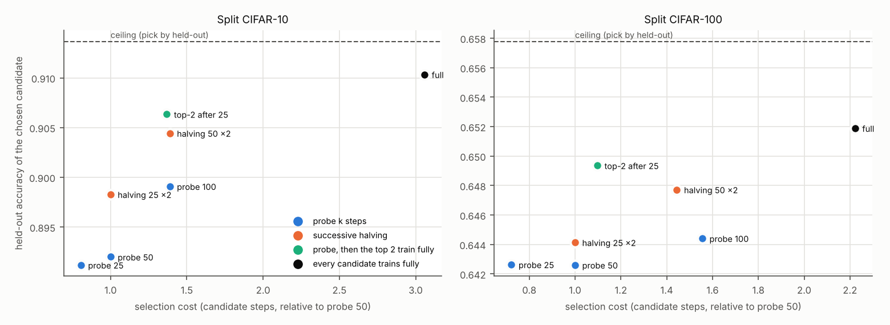

# VCM: Versioned Compositional Memory
### 带版本的组合式记忆

> 把知识拆成独立存储的基础单元，用带角色、多维相似度的指针组合出新概念；常用组合结果缓存起来，通过版本号实现惰性失效；稳定的缓存可以晋升为新的概念节点——从而在持续学习中减少遗忘、保留迁移，并让系统自己长出新概念。

**状态：** 原型 v0.1 已实现（符号层核心库 + 神经网络持续学习实验），见文末[原型实现与初步结果](#原型实现与初步结果v01)；
v0.2 把网络推广为“模板 + 角色槽”，用组合式任务专门检验晋升，见[组合式 MNIST](#神经层组合式-mnist专门检验晋升--正向迁移v02)；
v0.3 改进候选选择（逐步淘汰），见[候选选择](#候选选择别再漏选起步慢的概念v03)；
v0.4 补全相关工作并把最接近的 MNTDP 作为基线，见[与 MNTDP-D 的对比](#与-mntdp-d-的对比v04)

---

## 动机

持续学习的核心障碍是**灾难性遗忘**：学习新知识时，更新共享参数会覆盖旧知识。现有方法大致分为三类：

1. **正则化**：保护重要的旧权重（如 EWC）
2. **回放**：学新知识时复习旧知识
3. **结构隔离**：为新知识分配独立的参数或模块

VCM 主要属于第 3 类，并结合了第 2 类的思路，同时尝试解决持续学习中的另一个目标：**正向迁移**——让旧知识帮助学习新知识。

---

## 核心组件

### 1. 基础单元，独立存储
每个知识单元只存放最基本的信息。不同领域的知识分开存放，从结构上避免互相覆盖。

### 2. 多维相似度指针
单元之间通过指针相连，指针上标注**多个维度**的相似度，而不是单一数值。

例：西语 *salir*（出去）与法语 *salir*（弄脏）
| 维度 | 相似度 |
|---|---|
| 形式（拼写） | 1.0 |
| 语义 | ≈ 0 |
| 语法（词性） | 高 |

多维相似度可以避免被"假朋友"（拼写相同、含义不同的词）误导。

**快照引用：** 指针指向被引用单元的**冻结快照**，而不是活的引用，防止原件被修改时连带改变引用方（类似"写时复制"）。

### 3. 角色绑定组合
新概念由多个指针按**角色绑定**组合，而不是加权平均（加权平均会把不同来源的信息搅在一起，无法再分离）：

$$v = r_{\text{形}}\otimes f_{\text{salir}} + r_{\text{义}}\otimes f_{\text{出去}}$$

"形式来自哪里"与"意义来自哪里"各占一个角色槽，需要时可以干净地取出。

### 4. 条件变量
当两条知识在更新时互相冲突：
- 若条件是**固定的客观事实** → 两者中至少有一条是错的
- 若条件是**可变的** → 视为漏掉了一个隐藏变量，改用条件形式存储，让两者共存：

$$A \mid T_1,\qquad B \mid T_2$$

### 5. 组合缓存 + 版本号惰性失效
- 常用的组合结果**缓存**起来，供快速调用
- 每个基础单元带有一个**版本号**，每修改一次，版本号加一
- 每条缓存记录下它所依赖的各单元**当时的版本**
- 调用缓存时先比对版本：
  - 一致 → 直接使用
  - 不一致 → 重新组合，或删除这条缓存
- 是否出错，由外部反馈（人类或其他模型）判断

这样无需在底层单元被修改时立即更新所有缓存，避免了"级联爆炸"——而是**用到时再检查，过期了再修**。

### 6. 晋升机制：缓存 → 概念
一条缓存如果**被频繁调用**且**长期稳定、未失效过**，就晋升为一个正式的概念节点：
- 晋升后的概念可以被其他组合指向，在它的基础上继续组合
- 知识因此一层层向上搭建，形成越来越抽象的层级（对应认知科学中的**组块化**）

晋升后有两种模式可选：

| 模式 | 行为 | 优点 | 缺点 |
|---|---|---|---|
| 保持依赖 | 底层单元变化时跟随失效、重组 | 始终与原料一致 | 不够稳定，波及范围大 |
| 切断依赖 | 独立存在，不受原料变化影响 | 稳定、调用快 | 可能与原料逐渐脱节 |

类比：英语 *breakfast* 最初是 *break*（打破）+ *fast*（禁食），如今已是独立的词——这就是"切断依赖"后，概念从组合中独立出来的结果。

### 结构约束：有向无环图
所有指针只指向更底层的单元，整个知识结构保持为**有向无环图（DAG）**：
- 避免"A 用 B 解释、B 又用 A 解释"的循环
- 保证版本检查与失效传播一定会终止

---

## 整体流程

```
基础单元（独立存储，带版本号）
        │  多维相似度指针（指向快照）
        ▼
   角色绑定组合
        │
        ▼
   组合缓存（记录依赖版本）
        │  调用时比对版本 → 一致则使用 / 不一致则重组或删除
        │  频繁调用且长期稳定
        ▼
   晋升为新概念节点 ──→ 参与新的组合
```

---

## 相关工作

按与 VCM 的距离排列（最近的在前）。“神经层”指 `vcm/cl/` 里的实现。

| 工作 | 核心思路 | 与 VCM 的关系 |
|---|---|---|
| [MNTDP](https://arxiv.org/abs/2012.12631)（Veniat, Denoyer & Ranzato, ICLR 2021） | 模块化网络：每层一个模块库；新任务的网络 = 每层选一个旧模块或新建模块组成的路径。任务驱动先验：用每个旧任务的网络（去掉输出层）提取新任务的特征，用 15 近邻分类器在验证集上打分，取最相似的旧任务；只搜索“复用它的前 k 层 + 其余新建”的路径。MNTDP-D 把这些路径都训完、按验证准确率挑；旧模块冻结 | 与神经层 freeze 模式最接近（槽 ≈ 层，先验缩小候选 + 训练后挑选）。差别：MNTDP 只复用前缀，VCM 还按标签语义复用上层、并把整条组合晋升为可放进新角色槽的概念；MNTDP 的旧模块从不更新，所以没有版本、失效与裁决。**已作为基线实现**（`vcm/cl/learners/mntdp.py`，结果见下文） |
| [HOUDINI](https://arxiv.org/abs/1804.00218)（Valkov et al., NeurIPS 2018） | 把终身学习当作程序合成：神经网络是带类型的可微函数式程序，学过的神经函数进入函数库；新任务由类型引导的搜索决定复用哪些库函数、新学哪些。任务序列包括“识别 MNIST 数字 → 数某个数字出现几次 → 数字求和”等 | v0.2 的组合式 MNIST 与它的任务序列**高度相似**，“学过的函数整体放进新程序的槽”也正是我们“整条组合晋升后填入角色槽”的思路——这一点并不新。VCM 的差别在于：库里的函数由“被频繁调用且稳定”的缓存自动晋升而来，而且带版本号，共享部件被原地更新时有惰性失效与裁决；HOUDINI 的库函数学完即冻结，组合靠类型化的程序搜索 |
| [Lifelong Learning of Compositional Structures](https://arxiv.org/abs/2007.07732)（Mendez & Eaton, ICLR 2021） | 把组合式学习与终身学习结合：先学“怎样组合已有组件”来接纳新任务，再学“怎样调整组件集合”来容纳新任务；框架不依赖具体算法与结构形式 | 与 VCM 一样把“组合”与“组件更新”分开；它对组件做受控的调整，VCM 则用版本号 + 快照钉住 + 裁决决定旧组合是否接受更新后的组件 |
| [LMC：Local Module Composition](https://arxiv.org/abs/2111.07736)（Ostapenko et al., NeurIPS 2021） | 每个模块带一个局部结构组件，估计自己与输入的相关度，逐层按局部相关度组合；不需要任务编号；检测到离群输入时新增模块 | 同属模块化持续学习；LMC 按输入逐样本组合，VCM 按任务组合并用任务的输入统计推断任务（条件变量） |
| [PathNet](https://arxiv.org/abs/1701.08734)（Fernando et al., 2017）、[Progressive Neural Networks](https://arxiv.org/abs/1606.04671)（Rusu et al., 2016） | PathNet：用进化算法在大网络里选路径，只训练被选路径，旧任务的路径冻结；PNN：每个任务一列新网络，通过侧向连接利用冻结的旧列 | 结构隔离类方法的先驱；没有组合的缓存、版本与晋升 |
| [Voyager](https://arxiv.org/abs/2305.16291)（Wang et al., 2023） | 大语言模型智能体在 Minecraft 里持续积累可执行代码技能库，技能可以组合，按描述的向量检索取用 | “技能库 + 组合复用”在智能体层面的版本；技能经验证后入库，类似晋升，但没有版本号与失效机制 |
| [GRACE](https://arxiv.org/abs/2211.11031)（Hartvigsen et al., NeurIPS 2023） | 用离散键值码本给部署中的模型打补丁，原始权重冻结，按相似度决定是否启用补丁 | 补丁之间没有组合关系（神经层里有改编版 GRACE-CL 基线） |
| [Sparse Memory Finetuning](https://arxiv.org/abs/2510.15103)（Lin et al., 2025） | 在记忆层中只稀疏更新被新知识强烈激活的记忆槽，大幅减少遗忘 | 没有显式的组合结构与版本管理 |
| 向量符号架构（VSA）/ 神经-向量-符号架构（NVSA） | 用绑定、解绑、叠加运算把符号结构编码进向量 | 符号层的角色绑定直接用了 HRR；没有缓存、失效与晋升机制 |
| EWC 等正则化方法 | 保护对旧任务重要的参数 | 不改变存储结构（神经层基线之一） |

**VCM 的新意要说得窄一些**（据目前检索）：
- “冻结模块 + 按相似度挑选组合”不新（MNTDP、PathNet）；“学过的函数整体放进新组合的槽”也不新（HOUDINI）。
- VCM 想多回答的是两件事：（1）共享单元**被原地更新**时，用版本号 + 快照钉住 + 惰性检查 + 外部裁决来控制遗忘与维护开销；
  （2）把**被频繁调用且长期稳定的组合缓存自动晋升**为概念，并测清楚这件事在什么条件下有用、有用多少。
- 这两点的实验证据目前都只在小规模基准上（MNIST、小 CNN 上的 CIFAR），见下文。

## 实验计划

**数据集**（从小规模开始）
- Permuted MNIST
- Split CIFAR-10 / CIFAR-100

**基线**
- 普通微调（下限）
- EWC
- GRACE

**指标**
- 新任务的学习效果
- 旧任务的遗忘程度
- 将两条曲线画在同一张图上对比

**重点验证**
- 版本号惰性失效能否在减少遗忘的同时控制计算开销
- 晋升机制能否带来更好的正向迁移

---

## 原型实现与初步结果（v0.1）

> 以下所有数字都由仓库里的脚本生成，可以复现。完整表格在 `results/*/summary.md`，
> 设计细节与“哪些是实现者自己的选择”在 [`docs/design.md`](docs/design.md)，进度在 [`STATUS.md`](STATUS.md)。

### 快速开始

```bash
pip install -e ".[cl,dev]"                  # numpy；神经层另需 torch、matplotlib
python -m pytest -q                         # 符号层 + 神经层测试（神经层用合成数据，不需下载）
python experiments/symbolic_demos.py        # salir / breakfast / 条件变量
bash experiments/run_suite.sh pmnist        # Permuted MNIST 全部方法 × 3 个种子
bash experiments/run_suite.sh compose       # 组合式 MNIST（v0.2）：4 个数据量 × 11 种方法 × 5 个种子 + 强制读图器对照
```

> **默认设置**：VCM 学习器现在默认 `feedback_source="val"`（裁判用留出的验证样本）、`repair_steps=0`（不合格就保留旧快照，不修复），
> 即下文实验里表现更好的那组。下文 v0.1 的结果大多是在旧默认（裁判用训练样本、修复 100 步）下跑的，
> `run_suite.sh` 已显式固定这些旧参数，所以重跑仍得到同样的数字。用 `--eval-split val` 选超参数时，裁判会自动退回训练样本，避免看到被测数据。

### 代码结构

| 层 | 位置 | 内容 |
|---|---|---|
| 符号层（只依赖 numpy） | `vcm/` | 单元与版本、写时复制快照、多维相似度指针、角色绑定（HRR 循环卷积）、带外部裁决的版本化缓存、晋升（保持 / 切断依赖）、条件变量、DAG 约束 |
| 神经层（torch） | `vcm/cl/` | 把网络按“角色槽”切成单元，任务的网络 = 按模板（v0.2）在各槽绑定一个单元或一个晋升出的概念；与 Fine-tune / EWC / ER / Independent / GRACE-CL 对比 |
| 实验 | `experiments/` | 每个脚本顶部写了用法；`run_suite.sh` 是结果背后的确切命令 |

### 符号层：机制本身是否成立

1. **多维相似度避开假朋友，角色绑定可以干净拆开**（[`results/symbolic_demos.md`](results/symbolic_demos.md)）。
   只看形式时，`es:salir` 的最近邻是 `fr:salir`（假朋友）；按 meaning 维度检索得到 `fr:sortir`。
   $v = r_{形}\otimes f_{salir} + r_{义}\otimes f_{出去}$ 解绑后两个角色都能取回正确来源；加权平均向量与两个来源一样近，分不出谁是“形”谁是“义”。
2. **惰性失效的计算开销**（[`results/cache_cost/`](results/cache_cost/cache_cost.md)）。随机两层知识图，读写混合的事件流。
   每个事件平均需要重新计算的组合数，在所有更新频率下都是 惰性 ≤ 立即失效、惰性 ≤ 无缓存；
   例如更新概率 0.2、均匀读取时为 0.59 / 1.53 / 1.63，Zipf 读取时惰性只要 0.35。所有读到的结果与“从当前单元重新组合”一致（误差 3e-16）。

   
3. **晋升让组合可以一层层往上搭**（[`results/promotion_depth/`](results/promotion_depth/promotion_depth.md)）。
   逐层解绑一棵组合树：不晋升时中间结果无法清理，噪声逐层累积；晋升后每一跳都能先清理再继续。
   d = 1024、每层 3 个角色时，4 层深的解码准确率：不晋升 0.66，晋升 1.00；代价是清理记忆从 500 条增至 1460 条。

   

### 神经层：Permuted MNIST（10 个任务，3 个种子）

MLP 784-256-256-10，每任务 1 个 epoch；测试时**不给任务编号**——对 VCM 来说“任务”就是那个隐藏的条件变量，
由输入的最近质心推断（路由准确率 100%）。EWC 的 λ、GRACE-CL 的 ε 在验证集上选定。

| 方法 | 最终平均准确率 | 遗忘 | 前向迁移（对 Independent） | 计算 (GMAC) | 参数 (M) | 缓冲 (M) |
|---|---|---|---|---|---|---|
| Fine-tune | 0.546 | 0.460 | +0.008 | 441 | 0.27 | 0 |
| EWC (λ=100) | 0.875 | 0.056 | −0.030 | 449 | 0.27 | 0.54 |
| ER（每任务 200 样本） | 0.896 | 0.068 | +0.006 | 833 | 0.27 | 1.57 |
| GRACE-CL（改编，ε=1） | 0.572 | 0.010 | −0.412 | 79 | 0.27 | 9.25 |
| Independent（每任务一个新网络） | 0.952 | 0 | 0 | 441 | 2.69 | 0 |
| **VCM（freeze：复用单元冻结）** | 0.952 | **0** | +0.001 | 542 | 2.08 | 1.58 |
| **VCM（update + 惰性检查）** | **0.956** | 0.003 | **+0.007** | 551 | 2.21 | 1.58 |


GRACE-CL 遗忘很少，但码本是“记住见过的样本”，对新任务测试样本泛化差，且码本占 9.25M 浮点数。
VCM 在每个新任务上只新建输入层，复用旧任务的上层（因为任务间 `form` 相似度 ≈ 0.03、`semantic` = 1——正是多维相似度在网络上的用法）。
缓冲列里 VCM 的 1.58M 是裁决用的反馈样本，与 ER 的回放缓冲等量。

**压力测试：被复用的单元以全学习率原地更新**（[`results/pmnist_stress/`](results/pmnist_stress/summary.md)），这时版本检查和裁决才真正有活干：

| VCM 变体 | 最终平均准确率 | 遗忘 | 维护计算 (GMAC) | 保留的旧快照 |
|---|---|---|---|---|
| 不检查（过期一律接受） | 0.932 | 0.036 | 2.6 | 3.3 |
| 立即检查 + 裁决 + 修复 | 0.945 | 0.021 | 51.3 | 4.0 |
| 惰性检查 + 裁决 + 修复 | 0.944 | 0.023 | 35.4 | 4.7 |
| **惰性检查 + 裁决，不修复（不合格就保留旧快照）** | **0.955** | **0.011** | 2.6 | 8.7 |
| 惰性 + 晋升（切断依赖） | 0.957 | 0.005 | 2.6 | 0.7 |

**低数据：第 2 个任务起每任务只有 1000 个训练样本**（[`results/pmnist_few/`](results/pmnist_few/summary.md)）：
Independent 0.870；VCM 各变体 0.896–0.900，前向迁移 +0.032 ~ +0.035。

### 神经层：Split CIFAR-10（5 个两分类任务，任务增量，3 个种子）

小 CNN（3 个卷积块 + fc + 头），每任务 5 个 epoch，测试时给任务编号（每任务一个输出头）。

| 方法 | 最终平均准确率 | 遗忘 | 前向迁移（对 Independent） | 计算 (TMAC) | 参数 (M) | 缓冲 (M) |
|---|---|---|---|---|---|---|
| Fine-tune | 0.739 | 0.229 | +0.011 | 7.4 | 0.62 | 0 |
| EWC (λ=100) | 0.889 | 0.021 | −0.010 | 7.6 | 0.62 | 1.24 |
| ER（每任务 200 样本） | 0.893 | 0.032 | +0.004 | 13.3 | 0.62 | 3.07 |
| GRACE-CL（改编，ε=1） | 0.776 | 0 | −0.173 | 3.9 | 0.62 | 11.3 |
| Independent | **0.914** | 0 | 0 | 7.4 | 3.09 | 0 |
| VCM（freeze） | 0.901 | **0** | −0.014 | 11.1 | 2.87 | 3.09 |
| VCM（update + 惰性检查） | 0.907 | 0.008 | +0.001 | 12.4 | 2.90 | 3.09 |
| VCM（惰性 + 晋升） | 0.905 | 0.004 | −0.007 | 12.0 | 2.94 | 3.09 |



- VCM 在所有**持续学习**方法里最终准确率最高，遗忘 ≤ 0.008；它复用前 2–3 个卷积块，每个任务新建 fc 和输出头。
- 但**每任务一个新网络（Independent）更好**：每个两分类任务有 9000 张图，从头训练已经足够，
  复用别的两分类任务学到的卷积特征并没有带来正向迁移。
- VCM 的候选探测在 CNN 上很贵：仅训练部分就比 Independent 多约 45% 的计算（freeze 总计多 49%，update 因裁决与修复多 67%）。
- 只有 5 个任务时，查询流每轮都会碰到所有过期任务，惰性与立即检查的结果完全相同——惰性的省钱效果需要“很多任务、很少被问到的旧任务”才能显现。

### 神经层：Split CIFAR-100（10 个十分类任务，任务增量，3 个种子）

同样的 CNN 与设置；EWC 的 λ、GRACE 的 ε 沿用 CIFAR-10 上选出的值（没有单独搜索）。

| 方法 | 最终平均准确率 | 遗忘 | 前向迁移（对 Independent） | 计算 (TMAC) | 参数 (M) | 缓冲 (M) |
|---|---|---|---|---|---|---|
| Fine-tune | 0.385 | 0.340 | +0.069 | 7.5 | 0.64 | 0 |
| EWC (λ=100) | 0.538 | 0.058 | −0.046 | 7.9 | 0.64 | 1.29 |
| ER（每任务 200 样本） | 0.603 | 0.092 | +0.062 | 14.1 | 0.64 | 6.14 |
| GRACE-CL（改编，ε=1） | 0.508 | 0 | −0.135 | 3.6 | 0.64 | 34.6 |
| Independent | 0.629 | 0 | 0 | 7.5 | 6.20 | 0.03 |
| VCM（freeze） | 0.650 | **0** | +0.021 | 15.5 | 5.39 | 6.17 |
| **VCM（update + 惰性检查）** | **0.670** | 0.008 | **+0.047** | 18.9 | 5.74 | 6.17 |
| VCM（update + 立即检查） | 0.670 | 0.007 | +0.047 | 19.5 | 5.68 | 6.17 |
| VCM（惰性 + 晋升） | 0.662 | 0.007 | +0.038 | 16.8 | 5.58 | 6.17 |


- 这是 VCM 优势最明显的基准：十分类任务之间的卷积特征可以通用，复用带来 +2.1（冻结）到 +4.7（原地更新）个百分点的前向迁移，
  最终准确率比 Independent 高 4 个百分点，比 ER 高 7 个百分点，遗忘不到 0.01。
- 惰性与立即检查准确率相同，惰性少花约 16% 的维护计算（3.4 vs 4.1 TMAC），多留 2 个旧快照。
- 代价同样明显：VCM 的总计算是 Independent 的 2.1–2.6 倍（候选探测 + 裁决时的修复尝试）。

### 神经层：组合式 MNIST——专门检验“晋升 → 正向迁移”（v0.2）

v0.1 里晋升没有带来额外迁移。但那几个基准的任务结构都一样，晋升出的块只能放回原位，和逐层复用拿到的东西相同。
这一节换成**组合式任务**，给“概念当积木”一个公平的机会（设计细节见 [`docs/design.md`](docs/design.md) 2.6 节）：

- **任务流**（任务增量：测试时给任务编号，因为同一对图可以问不同的问题）：
  `digit`（读一张图的数字，27000 张训练图）→ `parity`（奇偶）→ `sum`（两张图求和，19 类）→ `equal`（是否同一个数字，正反各半）
  → `greater`（a > b）→ `diff`（|a − b|，10 类）。后 5 个任务各给 N 个训练样本（N = 100 / 250 / 1000 / 4000），
  图片取自 digit 没见过的另一半训练集；5 个种子。
- **模板 + 角色槽**：单图模板 `in → hidden → out`（就是 v0.1 的 MLP）；两图模板 `in → hidden`（两张图共用一个读图器）`→ mix → out`。
- **被比较的复用方式**：
  1. **逐层复用（不晋升）**：旧单元只能放到新模板里同名角色的位置。两图任务能拿到 digit 的 `in, hidden`，拿不到它的输出层；
  2. **v0.1 的共享块晋升**；
  3. **整条组合晋升**（按 README 原文“缓存 → 概念”）：digit 的整张网络被频繁查询、从未失效 → 晋升为“读数字”概念，
     整体填入两图模板的两个读图槽，新任务只需再学 `mix(2×10 → 256)` 和输出层。
- 超参数都在验证集上选（[`results/sweeps/compose.md`](results/sweeps/compose.md)）：每任务至少 500 步、候选探测 100 步、EWC λ = 1e5。

**第一步：概念作为积木本身值多少？**（[`results/compose_readers/`](results/compose_readers/readers.md)）
绕开学习器的选择，强制指定读图器；四个两图任务的测试准确率平均，5 个种子：

| 每任务样本数 | 整条概念 | 逐层（in+hidden，冻结） | 只有第一层 | 微调 in+hidden | 从零 | 概念 − 逐层（配对） |
|---|---|---|---|---|---|---|
| 50 | **0.509** | 0.481 | 0.392 | 0.412 | 0.352 | +0.029（5/5 种子为正） |
| 100 | **0.613** | 0.580 | 0.421 | 0.478 | 0.362 | +0.033（5/5） |
| 250 | **0.734** | 0.714 | 0.525 | 0.588 | 0.391 | +0.019（5/5） |
| 1000 | 0.866 | **0.871** | 0.802 | 0.818 | 0.483 | −0.005（0/5） |
| 4000 | 0.905 | 0.915 | **0.921** | 0.920 | 0.849 | −0.010（0/5） |
| 16000 | 0.915 | 0.926 | 0.943 | **0.947** | 0.909 | −0.012（0/5） |


**第二步：持续学习器自己能拿到多少？**（[`results/compose/`](results/compose/summary.md)）
两图任务刚学完时的测试准确率（四个任务平均，5 个种子）；最后三列取每任务 1000 个样本的那组：

| 方法 | 100 | 250 | 1000 | 4000 | 最终平均 ACC | 遗忘 | 计算 (GMAC) |
|---|---|---|---|---|---|---|---|
| Independent | 0.366 | 0.395 | 0.474 | 0.851 | 0.634 | 0 | 677 |
| Fine-tune | 0.485 | 0.608 | 0.842 | **0.932** | 0.875 | 0.010 | 677 |
| EWC (λ=1e5) | 0.558 | 0.705 | 0.875 | 0.919 | 0.905 | 0 | 686 |
| ER（每任务 200 样本） | 0.493 | 0.627 | 0.850 | **0.932** | 0.859 | 0.035 | 1044 |
| VCM（freeze，逐层复用） | 0.582 | 0.727 | 0.874 | 0.913 | 0.906 | 0 | 990 |
| VCM（freeze + v0.1 块晋升） | 0.583 | 0.727 | 0.873 | 0.916 | 0.905 | 0 | 1068 |
| **VCM（freeze + 整条组合晋升）** | 0.611 | **0.738** | **0.876** | 0.913 | **0.907** | 0 | 1132 |
| VCM（update + 惰性） | 0.537 | 0.678 | 0.866 | 0.925 | 0.892 | 0.009 | 991 |
| VCM（update + 整条组合晋升） | **0.615** | 0.732 | 0.867 | 0.927 | 0.896 | 0.007 | 1132 |

晋升与不晋升的配对差（同一种子；括号里是差值为正的种子数）：

| 比较 | 100 | 250 | 1000 | 4000 |
|---|---|---|---|---|
| 整条组合晋升 − 逐层复用（freeze） | **+0.029**（5/5） | **+0.012**（5/5） | +0.001（4/5） | −0.000（2/5） |
| v0.1 共享块晋升 − 逐层复用（freeze） | +0.001（4/5） | +0.000（3/5） | −0.001（1/5） | +0.002（3/5） |
| 立即晋升（门槛 = 0）− 按门槛晋升 | 0（逐位相同） | 0 | 0 | 0 |
| 整条组合晋升 − 逐层复用（update + 惰性） | +0.078（5/5） | +0.054（5/5） | +0.002（5/5） | +0.002（3/5） |
| 同第一行，但探测只有 50 步（v0.1 默认） | +0.028（5/5） | +0.007（5/5） | +0.002（3/5） | +0.008（4/5） |



读法：

- **少样本时，晋升出的概念确实是更好的积木，学习器也用上了。** 强制对照里，50–250 个样本时整条概念比逐层复用高 1.9–3.3 个百分点，
  5 个种子全部同号；持续学习器里是 +2.9（100 个样本）和 +1.2（250 个样本），4 个两图任务里平均有 2.6 / 2.2 个选了概念。
  按绝对值，带晋升的学习器（0.611 / 0.738）与强制用概念的读图器（0.613 / 0.734）持平；配对差比强制对照小，
  是因为不晋升的学习器本身比强制的逐层读图器强（它还能复用前一个两图任务的 `mix` 等）。
  〔v0.3 更正〕这里原先写“差的那部分在选择”，不准确：v0.3 的曲线重放显示，短探测漏选概念的代价只有 0.3–0.4 个百分点，见下一节。
- **优势随数据很快消失，数据多时反而吃亏。** 1000 个样本时持平；4000 以上冻结的“读数字”成了天花板——每张图约 3% 的读错率原样传下去，
  而微调或从零训练可以超过它（16000 个样本：概念 0.915 < 逐层 0.926 < 微调 0.947）。
- **概念多给的只有一层。** 逐层复用已经拿到了绝大部分迁移（100–1000 个样本时相对从零 +22–40 个百分点）；概念多带的是 digit 的输出层（一层线性映射），
  效果是新任务要学的参数从约 13 万降到约 0.6–1 万。少样本时更不容易过拟合，这是我们认为最可能的解释，但“参数更少”与“编码更干净”两种解释没有拆开测。
- **“频繁调用 + 长期稳定”这个门槛没起作用。** 把门槛设成 0（学完立即晋升）的对照与正常门槛逐位相同：每个组合在服务阶段被查询几十次、
  从不失效，早晚都会晋升。所以这里验证的是“整条组合可以作为一个单元，被放进新的角色槽”，而不是晋升的触发条件。
  parity 也被晋升了，但它丢掉了数字身份；主实验里没有一个两图任务选它。只有一次例外（探测 50 步的消融，种子 0、100 个样本）：
  以 digit 概念为读图器学会的 parity 被晋升成第 2 层概念，又被 equal 选中——探测时它只比 digit 概念低 0.4 个百分点，
  简约规则偏向参数更少的它。这是概念库里出现“假朋友”的一个实例。
- **这解释了 v0.1 的负面结果。** v0.1 的规则晋升的是“被多个任务共用的连续单元”（这里就是 digit 的 `in + hidden`），
  它和逐层复用拿到的东西完全一样，所以 ±0.2 个百分点，没有贡献。
- **update 模式下 +7.8 / +5.4 的差距主要不是晋升的功劳。** 逐层复用的 VCM（update）会以 0.1 倍学习率原地微调被复用的读图层，
  在 100–250 个样本上这反而有害（0.537 < freeze 的 0.582）；概念是冻结的，所以绕开了这个问题。与 freeze 下的概念臂相比两者持平。
- **如果新模板的读图槽不照抄旧网络的层结构**（强制对照里的“只有第一层”），逐层复用就只能拿到第一层，概念的优势变成 +12–21 个百分点（50–250 个样本）。
  这是晋升“让整块知识可被寻址”的价值，但它的大小是由模板怎么写决定的，不能当作独立的实验证据。
- 代价：VCM 的总计算是 Independent 的 1.5–1.7 倍（主要是候选探测）；cut 模式的概念副本（digit、parity 各约 0.27M 个浮点数）
  让存储的参数多 0.2–0.5M（新任务的头变小，抵掉了一部分）。

### 候选选择：别再漏选起步慢的概念（v0.3）

v0.2 里，候选组合各训练 100 步就比一次，概念读图器（输入是 10 维 logits）起步比 512 维特征慢，常被比下去。v0.3 加了两种选择方式
（`--selection`，见 [`docs/design.md`](docs/design.md) 2.7 节）：**逐步淘汰**（successive halving：都先训 50 步，留下一半，
预算翻倍再比……，计算与探测 100 步相同）和**全部训满再挑**（每个候选训满 500 步，2.6–2.9 倍计算，作为上限参照）。

**先看曲线**（[`results/selection/curves.md`](results/selection/curves.md)）。诊断模式把每个候选都训满并每 25 步记一次准确率，
8 个种子 × 4 个数据量；选择只看验证集前 1000 个样本，打分用另外 1000 个样本：



| 选择规则（重放） | 计算 | 100 个样本 | 250 | 1000 | 4000 |
|---|---|---|---|---|---|
| 探测 50 步 | 0.78 | 0.608（遗憾 0.003） | 0.729（0.007） | 0.867（0.003） | 0.914（0.006） |
| 探测 100 步（v0.2） | 1.00 | 0.608（0.003） | 0.732（0.004） | 0.868（0.002） | 0.914（0.007） |
| 曲线外推（100 步） | 1.00 | 0.605（0.006） | 0.729（0.008） | 0.868（0.002） | 0.904（0.017） |
| **逐步淘汰（50 步起，×2）** | 1.00 | 0.608（0.003） | **0.735（0.001）** | 0.867（0.003） | 0.916（0.004） |
| 全部训满再挑 | 2.78 | 0.608（0.004） | 0.734（0.003） | 0.867（0.003） | 0.919（0.001） |
| 天花板（按打分集挑） | 2.78 | 0.611 | 0.737 | 0.870 | 0.921 |

（两图任务的打分集准确率；括号里是“遗憾” = 天花板 − 所选候选。）

**再在学习器里实测**（[`results/selection/learner.md`](results/selection/learner.md)，测试集，5 个种子，与 v0.2 的探测 100 步逐种子配对）：

| VCM（freeze + 整条组合晋升） | 100 | 250 | 1000 | 4000 | 两图任务选概念（4 个里） | 计算 (GMAC) |
|---|---|---|---|---|---|---|
| 探测 100 步（v0.2） | 0.611 | 0.738 | 0.876 | 0.913 | 2.6 / 2.2 / 0.6 / 0.8 | 1132 |
| 逐步淘汰 | 0.611 | 0.740 | 0.874 | 0.912 | **3.0 / 3.4 / 1.2 / 1.2** | 1135 |
| 全部训满再挑 | 0.610 | 0.739 | 0.872 | **0.923**（+1.1，5/5） | 2.0 / 2.6 / 2.2 / 1.0 | 2890 |

读法：

- **漏选确实存在，逐步淘汰在同样计算下把它补上了大半。** 选择集上的领先者常在 100–300 步后才定下来（250 个样本时概念约在 75–100 步反超）；
  学习器里，250 个样本时概念的选中次数从 2.2 / 4 升到 3.4 / 4，1000 个样本时从 0.6 升到 1.2。
- **但漏选几乎不花钱，所以准确率没变。** 重放里，就算按打分集挑（天花板），也只比探测 100 步高 0.3–0.7 个百分点；
  学习器里（晋升臂）逐步淘汰与探测 100 步的差都在 ±0.2 以内。原因有两个：概念没被选上时，被选中的逐层方案终点几乎一样好；
  选择集只有 1000 个样本，单次判断有约 ±1.4 个百分点的噪声，与候选之间的差距同一量级——
  “全部训满再挑”在 100–1000 个样本时同样没有提高。
- **数据多时有一种真正值得救的“慢热”候选，但它不是概念。** 4000 个样本时全部训满高 1.1 个百分点（5/5 种子），
  收益集中在最需要容量的 sum（+1.1）和 diff（+2.2）：在这两个任务上，全部训满 5 次里分别有 3 次和 2 次选了
  “只复用第一层、自己再训一层”的方案（容量更大、起步更慢），探测和逐步淘汰在 sum 上一次都没选它。代价是 2.6 倍计算。
- **曲线外推不如直接比**：1000 个样本的选择集太吵，外推把噪声放大。
- **一个顺带的发现**：v0.2 的探测在选定后会换一个新的 Adam 接着训，逐步淘汰则一直沿用原来的。单独比“探测 100 步、不换优化器”
  可以看到，换优化器本身在 100–250 个样本时多拿约 0.4 个百分点（逐种子 0–1/5 为正）。扣掉这一项，
  逐步淘汰相对“不换优化器的探测”在晋升臂上是 +0.2 / +0.5 个百分点。这些效应都很小，没有在测试集上继续调，留作下一步在验证集上检验。
- 还试了“把概念的输出做一次固定的标准化，让它起步快一点”：反而更慢（logits 尺度被压小），放弃。
- **结论**：候选选择不是 VCM 在这个基准上的瓶颈；默认仍是 `--selection probe`（v0.1–v0.2 的结果因此不变），
  想少漏选概念可以用 `--selection halving`（同样计算），数据充足且不在乎计算时可以用 `full`。
  晋升的效果在三种选择方式下都一样：少样本时 +2.9～+3.3（100 个样本）、+1.2～+1.8（250 个样本），1000 个以上消失。

### 与 MNTDP-D 的对比（v0.4）

MNTDP 是与 VCM 神经层最接近的已有方法。我们按官方实现（github.com/TomVeniat/MNTDP，配置 `PSSN-search-6-fw`）在同一套角色槽上复现了 MNTDP-D
（[`vcm/cl/learners/mntdp.py`](vcm/cl/learners/mntdp.py)，改编点写在文件头）：用每个旧任务的网络（去掉输出层）提取新任务的特征，
15 近邻分类器在验证集上打分，取最相似的那个旧任务；候选 = 复用它的前 k 层 + 其余新建，**每条候选都训满**，按验证准确率挑；旧模块冻结。
与官方的差别：每条候选训练的步数与其他方法训练一个网络相同，不做官方那样的学习率 / 权重衰减网格和早停（VCM 也没有）。

| 基准 | 指标 | Independent | MNTDP-D | VCM（freeze） | VCM 其他变体 | 计算：MNTDP / VCM freeze / 变体 / Independent |
|---|---|---|---|---|---|---|
| Permuted MNIST（10 任务，全量） | 最终 ACC | 0.952 | 0.951 | 0.952 | **0.956**（update + 惰性） | 1244 / 542 / 551 / 441 GMAC |
| Permuted MNIST（后续任务各 1000 样本） | 最终 ACC | 0.870 | 0.872 | **0.898** | 0.896（update + 惰性） | 353 / 342 / 357 / 259 GMAC |
| Split CIFAR-10（5 任务） | 最终 ACC | 0.914 | **0.915** | 0.901 | 0.907（update + 惰性） | 31.4 / 11.1 / 12.4 / 7.4 TMAC |
| Split CIFAR-100（10 任务） | 最终 ACC | 0.629 | 0.655 | 0.650 | **0.670**（update + 惰性） | 35.0 / 15.5 / 18.9 / 7.5 TMAC |
| 组合式 MNIST，100 样本 | 两图任务学习准确率 | 0.366 | 0.575 | 0.582 | **0.611**（freeze + 组合晋升） | 1603 / 801 / 912 / 554 GMAC |
| 组合式 MNIST，250 样本 | 同上 | 0.395 | 0.722 | 0.727 | **0.738**（freeze + 组合晋升） | 2017 / 990 / 1132 / 677 GMAC |
| 组合式 MNIST，1000 样本 | 同上 | 0.474 | 0.873 | 0.874 | **0.876**（freeze + 组合晋升） | 2124 / 990 / 1132 / 677 GMAC |
| 组合式 MNIST，4000 样本 | 同上 | 0.851 | **0.927** | 0.913 | 0.913（freeze + 组合晋升） | 2201 / 990 / 1132 / 677 GMAC |

（Permuted MNIST 与 CIFAR 是 3 个种子，组合式 MNIST 是 5 个种子；每个基准的完整表格在 `results/*/summary.md`，MNTDP-D 已并入。）

读法：

- **VCM 胜在 MNTDP 做不到的那几件事上。**
  - Permuted MNIST：MNTDP 只复用“前几层”，而置换后的输入层没法复用——后 9 个任务 × 3 个种子共 27 次选择它全选了“从零”，
    结果等于 Independent，计算却是 2.8 倍；
    VCM 按标签语义复用上层，少样本时高 2.6 个百分点（3/3 种子）。
  - 组合式 MNIST 少样本：整条组合晋升出的“读数字”概念比 MNTDP-D 高 3.7 / 1.7 个百分点（100 / 250 个样本，5/5 种子）。
  - Split CIFAR-100：让共享单元原地更新（版本号 + 惰性检查 + 裁判）的 VCM 比 MNTDP-D 高 1.5 个百分点（3/3 种子），计算只有它的一半多一点。
- **两者实际上都只做“冻结的前缀复用”时，MNTDP-D 持平或更好**（CIFAR 的任务之间标签不重叠，VCM 也只复用下层）。 CIFAR-10 上它是所有方法里最好的（0.915，比 VCM freeze 高 1.3，0/3 种子 VCM 更好），
  CIFAR-100 上比 VCM freeze 高 0.5，组合式 MNIST 4000 个样本时高 1.4。它在 CIFAR-10 的 12 次选择里有 5 次选了“从零”——
  每条候选都训满再挑，能看出“这里复用没好处”；VCM 的短探测加“差不多就选参数少的”规则会选进无益的复用（VCM freeze 在 CIFAR-10 上前向迁移是 −0.014）。
- **代价**：MNTDP-D 的计算是 VCM freeze 的 2.0–2.8 倍（少样本 Permuted MNIST 例外：每个任务只有 40 步，两者几乎一样，1.03 倍），
  是 Independent 的 1.4–4.6 倍。
- **MNTDP-D 赢的部分全部来自选择预算，不来自它的先验。** 让 VCM（freeze）也“每条候选都训满再挑”（`--selection full`，3 个种子），
  在相同的计算下两者打平：CIFAR-10 上 0.914 vs 0.915，CIFAR-100 上 0.655 vs 0.655（都是 31.4 / 35.0 TMAC；
  [`results/split_cifar10_full/`](results/split_cifar10_full/summary.md)、[`results/split_cifar100_full/`](results/split_cifar100_full/summary.md)）。
  也就是说，15 近邻先验与“只复用前缀”的候选空间没有比 VCM 的相似度候选多带来什么；差别在于花不花 2–3 倍的计算去把每条候选训满。
  而 CIFAR-100 上 update + 惰性的 VCM（0.670，18.9 TMAC）比两者都好、也更省。
  〔v0.5〕只把探测后的前 2 名训满，就能用大约一半的计算拿到这部分收益的大半，见下一节。
- 我们的 MNTDP-D 没有官方的学习率网格与早停，可能比原论文的设置弱一些；网络也很小（MLP 与 3 层卷积）。这些数字只说明“同一套小规模设置下”的相对位置。

### 省计算拿到“训满再挑”的收益：Split CIFAR 上的候选选择（v0.5）

上一节的拆解说明，MNTDP-D 在 CIFAR 上多出来的准确率全部来自“每条候选都训满再挑”，代价是 2–3 倍计算。这一节问：能不能少花计算拿到它？
做法与 v0.3 相同：先在验证集的学习曲线上重放各种选择规则，按事先定好的标准挑出要上测试集的规则，再在学习器里实测
（[`results/selection_cifar/`](results/selection_cifar/curves.md)，设计见 [`docs/design.md`](docs/design.md) 2.7 节）。

**验证集：曲线重放。** VCM（freeze）每个决策的 5 个候选都训满，每 25 步记录一次；8 个种子，CIFAR-10 共 32 个决策、CIFAR-100 共 72 个。
CIFAR 的验证集太小，诊断运行改为留出训练池的 20%：选择集仍是学习器实际用的 1000 / 500 张，其余做留出打分集（代价是训练集少 11%）。

| 规则 | CIFAR-10：计算 / 增益 / 补回 | CIFAR-100：计算 / 增益 / 补回 |
|---|---|---|
| 探测 50 步（默认） | 1.00 / 0 / 0% | 1.00 / 0 / 0% |
| 探测 100 步 | 1.39 / +0.71 / 39% | 1.56 / +0.18 / 19% |
| 逐步淘汰，25 步起 ×2（与探测 50 同价） | 1.00 / +0.63 / 34% | 1.00 / +0.15 / 16% |
| 逐步淘汰，50 步起 ×2 | 1.39 / +1.24 / 68% | 1.44 / +0.51 / 55% |
| **探测 25 步，前 2 名训满** | 1.37 / **+1.43**（8/8 种子）/ 78% | 1.10 / **+0.68**（8/8）/ 73% |
| 全部训满再挑 | 3.06 / +1.83 / 100% | 2.22 / +0.93 / 100% |

（计算 = 候选训练步数之和，相对探测 50 步；增益 = 所选候选训满后在留出集上的准确率减去探测 50 的，单位百分点；补回 = 增益 / 全部训满的增益。其余规则见结果页。）



- **失败的样子很固定。** 复用 3 个冻结卷积块的 bottom3 只训 fc 和头，起步最快，终点却比 bottom2 / bottom1 低 1–3 个百分点；
  探测 50 步时它领先，或落后不到简约规则的 0.5 个百分点，于是被选中（CIFAR-100 上 72 次决策选了 71 次 bottom3）。
- **同价的逐步淘汰救不回来。** 第 25 步时，“训满后的赢家”有 84% / 88% 在前 3 名，第一轮留得住它；但第 50 步时只有 50% / 71% 在前 2 名，
  第二轮在 50 步就分出胜负，还是太早。
- **前 2 名训满为什么有效。** 第 25 步的前两名几乎总是 bottom3 + bottom2（25/32、66/72），两个都训到底再比，bottom3 的低天花板就露出来了。
  代价是多训一个候选到底；CIFAR-100 每个任务只有 180 步，这只多 10%。

按事先定好的标准，测试集上跑两条规则：① 与探测 50 同价的逐步淘汰（要回答的问题本身，无论重放结果如何都跑）；
② 计算不超过 1.5 倍的规则里，两个基准平均增益最大的一条，即“探测 25 步、前 2 名训满”（`--selection finalists --probe-steps 25`）。

**测试集：学习器实测。** 与 v0.1 / v0.4 同样的设置，3 个种子，与已有的探测 / 训满 / MNTDP-D 运行逐种子配对
（当前环境重跑旧命令能逐位复现旧结果）：

| 方法 | CIFAR-10 ACC | 对探测 50（配对） | 计算 (TMAC) | CIFAR-100 ACC | 对探测 50（配对） | 计算 (TMAC) |
|---|---|---|---|---|---|---|
| VCM freeze，探测 50 步（默认） | 0.901 | – | 11.1 | 0.650 | – | 15.5 |
| VCM freeze，逐步淘汰（同价） | 0.904 | +0.22（2/3） | 11.3 | 0.649 | −0.13（1/3） | 15.7 |
| **VCM freeze，探测 25 步 + 前 2 名训满** | 0.907 | +0.55（2/3） | 15.0 | 0.657 | **+0.71**（2/3） | 17.6 |
| VCM freeze，全部训满再挑 | 0.914 | +1.28（3/3） | 31.4 | 0.655 | +0.50（3/3） | 35.0 |
| MNTDP-D | **0.915** | | 31.4 | 0.655 | | 35.0 |
| VCM update + 惰性，探测 50 步 | 0.907 | | 12.4 | 0.670 | | 18.9 |
| VCM update + 惰性，探测 25 步 + 前 2 名训满 | 0.911 | +0.40（2/3） | 16.3 | **0.671** | +0.11（1/3） | 20.6 |

读法：

- **同价的逐步淘汰：不行。** 验证集上只补回 34% / 16%，测试集上 +0.2 / −0.1 个百分点，都在噪声以内。
- **探测 25 步 + 前 2 名训满：用约 1/5（CIFAR-10）和 1/9（CIFAR-100）的额外计算，拿到训满收益的大半。**
  两个基准平均，测试集上 +0.63，训满是 +0.89（约七成）；验证集上是 73%–78%，8/8 个种子为正。
  总计算是训满（也是 MNTDP-D）的一半左右：CIFAR-100 上 0.657 对 MNTDP-D 的 0.655（17.6 对 35.0 TMAC）；CIFAR-10 上仍比它低 0.8。
- **但测试集上的证据偏弱，CIFAR-10 上也比预期少。** 两个基准各只有 2/3 个种子为正，配对差的标准误约 0.4–0.5 个百分点，与效应同级；
  CIFAR-10 上补回 43%，低于验证集的 78%，差距约 1 个标准误。机制上它也有上限：决赛名单几乎总是 bottom3 + bottom2，
  训满时常被选中的 bottom1（测试集上 12 次里 5 次）起步太慢，进不了决赛。只在验证曲线上看（看过测试集之后才加的事后探索，没有上测试集）：
  让前 3 名进决赛可以补回 86% / 97%，计算是 1.93 / 1.47 倍。
- **对 update + 惰性的 VCM，选择方式几乎无关**（CIFAR-10 上两条规则都约 +0.4，CIFAR-100 上 −0.2 / +0.1）：被复用的卷积块以 0.1 倍学习率继续训练，
  bottom3 没有“冻结带来的低天花板”，选它不吃亏。CIFAR-100 上它仍是最好也最省的一组。
- **默认仍是 `--selection probe`**（旧结果因此不变）。用 VCM freeze、想要训满的收益又不想付 2–3 倍计算时，用 `--selection finalists --probe-steps 25`。

### 对两个“重点验证”的回答（截至 v0.4 的证据）

**1. 版本号惰性失效能否在减少遗忘的同时控制计算开销？——部分能。**
- 减少遗忘：共享单元被原地改写时，带版本检查与裁决的 VCM 把遗忘从 0.036（不检查）降到 0.011–0.023（Permuted MNIST 压力测试）；
  在 CIFAR-100 上，原地更新 + 裁决的遗忘只有 0.008，同时拿到了最高的准确率。
- 控制开销：四组实验里，惰性与立即检查的准确率都相同；惰性的维护计算少 16%–31%（CIFAR-10 例外：只有 5 个任务，
  每轮查询都会碰到所有过期任务，于是两者完全一样），代价是旧快照在内存里多留一阵。符号层模拟里，惰性的优势随更新频率增大而急剧扩大。
- 但要说清楚：维护省下的是 VCM 自己的开销。VCM 整体比基线贵——候选探测和修复尝试使总计算达到 Independent 的 1.2–2.6 倍。
- 与最接近的已有方法 MNTDP-D（只冻结、不更新）相比（v0.4）：CIFAR-100 上原地更新 + 惰性检查 + 裁判的 VCM 高 1.5 个百分点（3/3 种子），
  计算约为它的一半；但在 CIFAR-10 上 MNTDP-D 更好（高 0.7），说明“允许原地更新”并不总是值得。
- 意外的负面结果：“修复”（用 200 个样本的小缓冲区重训任务私有单元）不可靠——它能通过缓冲区上的验收，却在测试集上更差。
  把裁判的样本换成留出的验证数据后有所改善（遗忘 0.023 → 0.017），但仍不如“不合格就保留旧快照”。

**2. 晋升能否带来更好的正向迁移？——在组合式任务上有，但只在少样本区间，而且幅度小。**
- v0.1（Permuted MNIST、Split CIFAR）：前向迁移确实存在，但来自组合式复用本身；晋升没有在复用之上再增加迁移，
  它换来的是**维护开销下降 30%–96%**（新任务指向冻结的概念后几乎不再让旧任务失效）。
- v0.2（组合式 MNIST）：把整条组合晋升为“读数字”概念、整体填入两图模板的读图槽后，每任务 100 / 250 个样本时
  比逐层复用高 2.9 / 1.2 个百分点（5/5 种子）；强制对照里 50–250 个样本时高 1.9–3.3 个百分点。1000 个样本起优势消失，
  4000 个以上冻结的概念反而成为上限。
- 起作用的是“整条组合可以作为一个单元放进新的角色槽”，不是晋升门槛（门槛设为 0 结果逐位相同），
  也不是 v0.1 那种共享块晋升（与逐层复用拿到的东西相同，零贡献）。
- v0.4：同样的少样本区间里，晋升的 VCM 也比 MNTDP-D 高 3.7 / 1.7 个百分点（5/5 种子）；数据充足时 MNTDP-D 反而更好。
- 符号层上晋升的收益是确定的（深层组合可以逐层清理）。

### 已知局限

- `form` 相似度只看输入像素的均值/标准差，对自然图像太粗；任务路由用最近质心，只适用于任务身份能从输入看出来的场景。
- 计算量按乘加次数估计，冻结层的反向传播也按完整网络计费（对 VCM 偏保守）。
- GRACE 原为模型编辑设计，GRACE-CL 是我们的改编（规则按官方实现，改编点写在 `vcm/cl/learners/grace.py`）。
- 组合式 MNIST 只有一种“概念”（读数字）和一层组合；更深的组合（用晋升出的 `sum` 去做三个数相加）还没有测。
- 晋升出的概念是冻结的：数据多时它成为上限。候选探测太短时会漏选它，但代价很小（v0.3）。
- 选择集固定为 1000 个验证样本，即使任务只有 100 个训练样本——这比真实的少样本场景宽裕，现实中选择会更吵。
- Split CIFAR 上的选择研究（v0.5）：测试集只有 3 个种子，单个基准上的配对差与其标准误同级，靠的主要是验证集曲线重放（8 个种子）；
  曲线诊断为了切出留出打分集，训练集比正式运行少 11%。“前 2 名训满”在组合式 MNIST 上没有测（概念读图器起步慢，可能进不了决赛）。
- 更多见 [`docs/design.md`](docs/design.md) 第 3 节。

---

## 许可证

[MIT](LICENSE)
