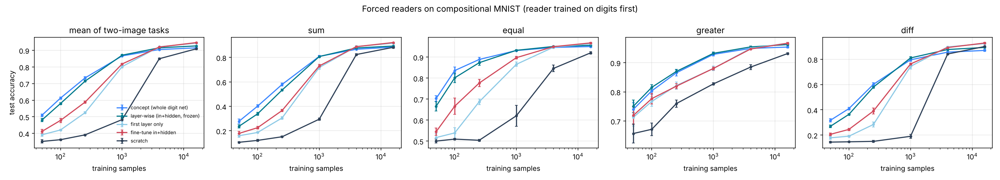

# 强制读图器：晋升出的概念作为积木本身值多少

种子 [0, 1, 2, 3, 4]；每个两图任务训练 500 步；测试集准确率，均值 ± 标准差（跨种子）。读数字网络在测试集上的准确率：0.9683。

## 四个两图任务的平均

| 训练样本数 | concept (whole digit net) | layer-wise (in+hidden, frozen) | first layer only | fine-tune in+hidden | scratch | 概念 − 逐层（配对差，跨种子） |
|---|---|---|---|---|---|---|
| 50 | 0.509 ± 0.008 | 0.481 ± 0.010 | 0.392 ± 0.010 | 0.412 ± 0.012 | 0.352 ± 0.010 | +0.029 ± 0.008（5/5 个种子为正） |
| 100 | 0.613 ± 0.007 | 0.580 ± 0.005 | 0.421 ± 0.004 | 0.478 ± 0.013 | 0.362 ± 0.004 | +0.033 ± 0.005（5/5 个种子为正） |
| 250 | 0.734 ± 0.007 | 0.714 ± 0.006 | 0.525 ± 0.006 | 0.588 ± 0.007 | 0.391 ± 0.004 | +0.019 ± 0.002（5/5 个种子为正） |
| 1000 | 0.866 ± 0.004 | 0.871 ± 0.002 | 0.802 ± 0.008 | 0.818 ± 0.004 | 0.483 ± 0.012 | -0.005 ± 0.004（0/5 个种子为正） |
| 4000 | 0.905 ± 0.003 | 0.915 ± 0.001 | 0.921 ± 0.003 | 0.920 ± 0.002 | 0.849 ± 0.005 | -0.010 ± 0.002（0/5 个种子为正） |
| 16000 | 0.915 ± 0.003 | 0.926 ± 0.001 | 0.943 ± 0.002 | 0.947 ± 0.001 | 0.909 ± 0.004 | -0.012 ± 0.002（0/5 个种子为正） |

## sum

| 训练样本数 | concept | layerwise | first | finetune | scratch |
|---|---|---|---|---|---|
| 50 | 0.278 ± 0.017 | 0.237 ± 0.013 | 0.160 ± 0.013 | 0.179 ± 0.017 | 0.106 ± 0.006 |
| 100 | 0.402 ± 0.011 | 0.339 ± 0.013 | 0.186 ± 0.005 | 0.225 ± 0.010 | 0.121 ± 0.008 |
| 250 | 0.580 ± 0.013 | 0.534 ± 0.009 | 0.306 ± 0.011 | 0.366 ± 0.010 | 0.151 ± 0.005 |
| 1000 | 0.809 ± 0.009 | 0.808 ± 0.004 | 0.718 ± 0.015 | 0.731 ± 0.014 | 0.295 ± 0.010 |
| 4000 | 0.867 ± 0.004 | 0.878 ± 0.004 | 0.890 ± 0.006 | 0.889 ± 0.002 | 0.824 ± 0.007 |
| 16000 | 0.885 ± 0.002 | 0.894 ± 0.002 | 0.917 ± 0.003 | 0.923 ± 0.001 | 0.884 ± 0.009 |

## equal

| 训练样本数 | concept | layerwise | first | finetune | scratch |
|---|---|---|---|---|---|
| 50 | 0.703 ± 0.014 | 0.666 ± 0.022 | 0.517 ± 0.018 | 0.545 ± 0.017 | 0.500 ± 0.009 |
| 100 | 0.836 ± 0.016 | 0.801 ± 0.024 | 0.539 ± 0.025 | 0.666 ± 0.039 | 0.510 ± 0.004 |
| 250 | 0.889 ± 0.010 | 0.873 ± 0.013 | 0.688 ± 0.014 | 0.776 ± 0.018 | 0.504 ± 0.005 |
| 1000 | 0.931 ± 0.002 | 0.932 ± 0.003 | 0.866 ± 0.010 | 0.897 ± 0.006 | 0.621 ± 0.050 |
| 4000 | 0.946 ± 0.004 | 0.951 ± 0.003 | 0.947 ± 0.003 | 0.950 ± 0.003 | 0.846 ± 0.016 |
| 16000 | 0.950 ± 0.004 | 0.956 ± 0.004 | 0.964 ± 0.003 | 0.968 ± 0.003 | 0.920 ± 0.005 |

## greater

| 训练样本数 | concept | layerwise | first | finetune | scratch |
|---|---|---|---|---|---|
| 50 | 0.740 ± 0.023 | 0.750 ± 0.022 | 0.712 ± 0.029 | 0.719 ± 0.030 | 0.657 ± 0.033 |
| 100 | 0.804 ± 0.012 | 0.816 ± 0.010 | 0.767 ± 0.016 | 0.777 ± 0.019 | 0.672 ± 0.022 |
| 250 | 0.865 ± 0.010 | 0.870 ± 0.008 | 0.822 ± 0.012 | 0.819 ± 0.009 | 0.760 ± 0.013 |
| 1000 | 0.929 ± 0.005 | 0.932 ± 0.004 | 0.880 ± 0.008 | 0.880 ± 0.005 | 0.827 ± 0.004 |
| 4000 | 0.949 ± 0.003 | 0.954 ± 0.003 | 0.949 ± 0.001 | 0.947 ± 0.003 | 0.885 ± 0.008 |
| 16000 | 0.954 ± 0.003 | 0.962 ± 0.002 | 0.967 ± 0.003 | 0.967 ± 0.003 | 0.931 ± 0.003 |

## diff

| 训练样本数 | concept | layerwise | first | finetune | scratch |
|---|---|---|---|---|---|
| 50 | 0.317 ± 0.014 | 0.269 ± 0.011 | 0.178 ± 0.012 | 0.206 ± 0.010 | 0.144 ± 0.007 |
| 100 | 0.409 ± 0.010 | 0.364 ± 0.007 | 0.191 ± 0.006 | 0.245 ± 0.009 | 0.147 ± 0.004 |
| 250 | 0.602 ± 0.014 | 0.580 ± 0.009 | 0.284 ± 0.020 | 0.390 ± 0.025 | 0.150 ± 0.008 |
| 1000 | 0.796 ± 0.013 | 0.811 ± 0.010 | 0.744 ± 0.021 | 0.763 ± 0.008 | 0.190 ± 0.015 |
| 4000 | 0.857 ± 0.006 | 0.877 ± 0.003 | 0.898 ± 0.005 | 0.893 ± 0.003 | 0.842 ± 0.005 |
| 16000 | 0.870 ± 0.008 | 0.894 ± 0.005 | 0.925 ± 0.005 | 0.929 ± 0.005 | 0.901 ± 0.005 |

