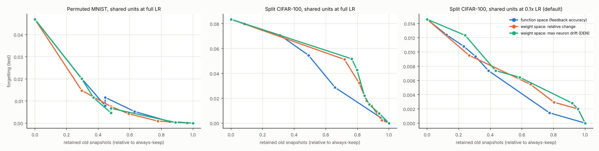
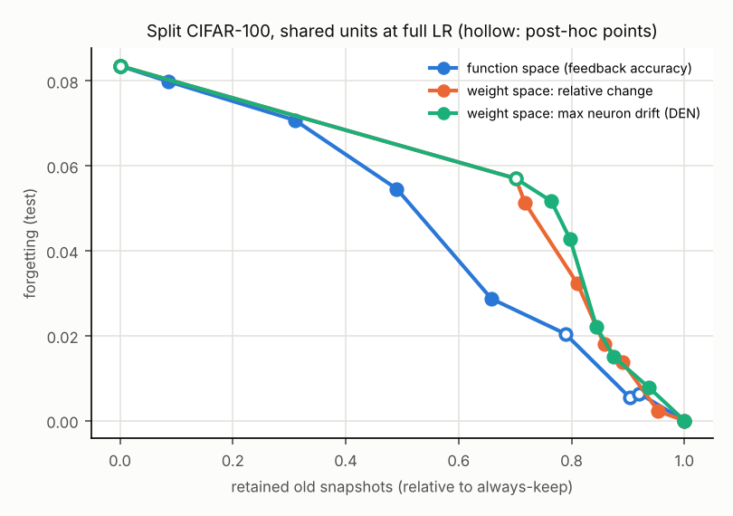

# 证伪实验：函数空间裁判 vs DEN 式权重空间裁判

VCM（update + 惰性），只换“旧任务是否接受共享单元的新版本”的裁判；其余设置一律相同（反馈缓冲区每任务 200 个验证样本、不修复、探测选组合）。“保留内存”= 跑完后把所有待检查的旧任务结算一遍、仍被钉住的旧快照的浮点数，按同种子“永远退回”归一化。遗忘、最终 ACC 在测试集上测；均值 ± 标准差跨种子。事先登记的判据见 `plan.md`。

## Permuted MNIST（10 任务，共享层以全学习率原地更新）（3 个种子）

| 裁判 | 阈值 | 最终 ACC | 遗忘 | 保留内存（归一化） | 参数总量 (M) | 接受 / 保留 | 维护计算 (GMAC) |
|---|---|---|---|---|---|---|---|
| accept | 1 | 0.9218 ± 0.0045 | 0.0469 ± 0.0044 | 0.00 | 2.08 | 40.7 / 0.0 | 2.6 |
| function_q10 | -0.005 | 0.9632 ± 0.0017 | 0.0007 ± 0.0006 | 0.85 | 2.60 | 1.7 / 39.0 | 2.6 |
| function_q30 | 0.005 | 0.9593 ± 0.0026 | 0.0053 ± 0.0026 | 0.63 | 2.47 | 13.0 / 27.7 | 2.6 |
| function_q50 | 0.01 | 0.9570 ± 0.0019 | 0.0079 ± 0.0015 | 0.44 | 2.35 | 17.3 / 23.3 | 2.6 |
| function_q70 | 0.02 | 0.9536 ± 0.0024 | 0.0116 ± 0.0022 | 0.44 | 2.35 | 22.3 / 18.3 | 2.6 |
| function_q90 | 0.045 | 0.9460 ± 0.0025 | 0.0201 ± 0.0028 | 0.30 | 2.26 | 31.7 / 9.0 | 2.6 |
| weight_rel_q10 | 0.1728 | 0.9637 ± 0.0011 | 0.0001 ± 0.0002 | 0.96 | 2.67 | 0.3 / 40.3 | 0.5 |
| weight_rel_q30 | 0.1924 | 0.9630 ± 0.0013 | 0.0009 ± 0.0002 | 0.78 | 2.56 | 3.0 / 37.7 | 0.5 |
| weight_rel_q50 | 0.2085 | 0.9601 ± 0.0015 | 0.0042 ± 0.0010 | 0.59 | 2.44 | 9.3 / 31.3 | 0.5 |
| weight_rel_q70 | 0.2487 | 0.9573 ± 0.0034 | 0.0075 ± 0.0034 | 0.48 | 2.37 | 16.3 / 24.3 | 0.5 |
| weight_rel_q90 | 0.3033 | 0.9508 ± 0.0047 | 0.0147 ± 0.0049 | 0.30 | 2.26 | 24.3 / 16.3 | 0.5 |
| weight_neuron_q10 | 0.3769 | 0.9636 ± 0.0012 | 0.0003 ± 0.0001 | 0.89 | 2.62 | 1.0 / 39.7 | 0.5 |
| weight_neuron_q30 | 0.4246 | 0.9598 ± 0.0010 | 0.0046 ± 0.0023 | 0.48 | 2.37 | 10.3 / 30.3 | 0.5 |
| weight_neuron_q50 | 0.4327 | 0.9579 ± 0.0028 | 0.0067 ± 0.0041 | 0.48 | 2.37 | 13.7 / 27.0 | 0.5 |
| weight_neuron_q70 | 0.4795 | 0.9535 ± 0.0045 | 0.0115 ± 0.0056 | 0.37 | 2.31 | 19.7 / 21.0 | 0.5 |
| weight_neuron_q90 | 0.5375 | 0.9460 ± 0.0067 | 0.0200 ± 0.0065 | 0.30 | 2.26 | 28.7 / 12.0 | 0.5 |
| keep | -1 | 0.9638 ± 0.0012 | 0.0000 ± 0.0000 | 1.00 | 2.69 | 0.0 / 40.7 | 2.6 |

帕累托前沿下的面积（遗忘：越小越好；ACC：越大越好），逐种子：

| 裁判 | 遗忘面积 | ACC 面积 |
|---|---|---|
| 函数空间（反馈样本准确率降幅） | 0.0129（0.0132, 0.0145, 0.0110） | 0.9519（0.9527, 0.9493, 0.9537） |
| 权重空间：整层相对变化 | 0.0123（0.0133, 0.0114, 0.0121） | 0.9529（0.9526, 0.9522, 0.9540） |
| 权重空间：单个神经元的最大变化（DEN） | 0.0124（0.0142, 0.0116, 0.0114） | 0.9525（0.9510, 0.9520, 0.9546） |

函数空间对 weight_rel：遗忘面积减少 -0.0006（相对 -5%），2/3 个种子更好 → 未达到判据

函数空间对 weight_neuron：遗忘面积减少 -0.0005（相对 -4%），2/3 个种子更好 → 未达到判据

每种统计量能否预测“真实损伤”（留出样本上准确率下降 > 0.02）：全部 2074 次裁判调用，其中 782 次有真实损伤。AUROC：

| 统计量 | AUROC |
|---|---|
| 函数空间（反馈样本准确率降幅） | 0.940 |
| 权重空间：整层相对变化 | 0.833 |
| 权重空间：单个神经元的最大变化（DEN） | 0.849 |

## Split CIFAR-100（10 任务，共享层以全学习率原地更新）（3 个种子）

| 裁判 | 阈值 | 最终 ACC | 遗忘 | 保留内存（归一化） | 参数总量 (M) | 接受 / 保留 | 维护计算 (GMAC) |
|---|---|---|---|---|---|---|---|
| accept | 1 | 0.6285 ± 0.0026 | 0.0836 ± 0.0044 | 0.00 | 4.17 | 40.7 / 0.0 | 104.1 |
| function_q10 | 0.045 | 0.6779 ± 0.0060 | 0.0287 ± 0.0075 | 0.66 | 5.51 | 11.0 / 29.7 | 104.1 |
| function_q30 | 0.085 | 0.6546 ± 0.0047 | 0.0546 ± 0.0064 | 0.49 | 5.18 | 23.0 / 17.7 | 104.1 |
| function_q50 | 0.12 | 0.6400 ± 0.0141 | 0.0708 ± 0.0171 | 0.31 | 4.85 | 32.7 / 8.0 | 104.1 |
| function_q70 | 0.19 | 0.6318 ± 0.0072 | 0.0799 ± 0.0095 | 0.09 | 4.37 | 39.3 / 1.3 | 104.1 |
| function_q90 | 0.34 | 0.6285 ± 0.0026 | 0.0836 ± 0.0044 | 0.00 | 4.17 | 40.7 / 0.0 | 104.1 |
| weight_rel_q10 | 0.1667 | 0.7017 ± 0.0010 | 0.0022 ± 0.0014 | 0.95 | 6.11 | 1.0 / 39.7 | 21.7 |
| weight_rel_q30 | 0.1955 | 0.6913 ± 0.0076 | 0.0138 ± 0.0092 | 0.89 | 5.98 | 6.3 / 34.3 | 21.7 |
| weight_rel_q50 | 0.2182 | 0.6875 ± 0.0055 | 0.0180 ± 0.0075 | 0.86 | 5.92 | 8.7 / 32.0 | 21.7 |
| weight_rel_q70 | 0.2484 | 0.6747 ± 0.0109 | 0.0323 ± 0.0135 | 0.81 | 5.82 | 14.7 / 26.0 | 21.7 |
| weight_rel_q90 | 0.4137 | 0.6576 ± 0.0065 | 0.0513 ± 0.0085 | 0.72 | 5.64 | 27.3 / 13.3 | 21.7 |
| weight_neuron_q10 | 0.343 | 0.6967 ± 0.0065 | 0.0078 ± 0.0079 | 0.94 | 6.07 | 3.7 / 37.0 | 21.7 |
| weight_neuron_q30 | 0.3803 | 0.6901 ± 0.0036 | 0.0151 ± 0.0053 | 0.87 | 5.95 | 6.3 / 34.3 | 21.7 |
| weight_neuron_q50 | 0.3845 | 0.6838 ± 0.0056 | 0.0221 ± 0.0073 | 0.84 | 5.89 | 9.0 / 31.7 | 21.7 |
| weight_neuron_q70 | 0.4432 | 0.6653 ± 0.0083 | 0.0427 ± 0.0105 | 0.80 | 5.79 | 21.7 / 19.0 | 21.7 |
| weight_neuron_q90 | 0.5043 | 0.6572 ± 0.0066 | 0.0517 ± 0.0088 | 0.76 | 5.73 | 27.0 / 13.7 | 21.7 |
| keep | -1 | 0.7037 ± 0.0013 | 0.0000 ± 0.0000 | 1.00 | 6.20 | 0.0 / 40.7 | 104.1 |

帕累托前沿下的面积（遗忘：越小越好；ACC：越大越好），逐种子：

| 裁判 | 遗忘面积 | ACC 面积 |
|---|---|---|
| 函数空间（反馈样本准确率降幅） | 0.0471（0.0430, 0.0459, 0.0526） | 0.6613（0.6631, 0.6635, 0.6572） |
| 权重空间：整层相对变化 | 0.0543（0.0485, 0.0613, 0.0531） | 0.6546（0.6582, 0.6496, 0.6561） |
| 权重空间：单个神经元的最大变化（DEN） | 0.0552（0.0452, 0.0611, 0.0592） | 0.6530（0.6579, 0.6498, 0.6511） |

函数空间对 weight_rel：遗忘面积减少 +0.0072（相对 13%），3/3 个种子更好 → 未达到判据

函数空间对 weight_neuron：遗忘面积减少 +0.0080（相对 15%），3/3 个种子更好 → 未达到判据

每种统计量能否预测“真实损伤”（留出样本上准确率下降 > 0.02）：全部 2074 次裁判调用，其中 1955 次有真实损伤。AUROC：

| 统计量 | AUROC |
|---|---|
| 函数空间（反馈样本准确率降幅） | 0.730 |
| 权重空间：整层相对变化 | 0.663 |
| 权重空间：单个神经元的最大变化（DEN） | 0.660 |

## Split CIFAR-100（默认：共享层以 0.1 倍学习率更新）（3 个种子）

| 裁判 | 阈值 | 最终 ACC | 遗忘 | 保留内存（归一化） | 参数总量 (M) | 接受 / 保留 | 维护计算 (GMAC) |
|---|---|---|---|---|---|---|---|
| accept | 1 | 0.6648 ± 0.0003 | 0.0146 ± 0.0004 | 0.00 | 5.39 | 40.7 / 0.0 | 104.1 |
| function_q10 | -0.015 | 0.6728 ± 0.0014 | 0.0014 ± 0.0010 | 0.77 | 6.02 | 4.7 / 36.0 | 104.1 |
| function_q30 | 0.005 | 0.6703 ± 0.0026 | 0.0074 ± 0.0029 | 0.39 | 5.70 | 18.3 / 22.3 | 104.1 |
| function_q50 | 0.02 | 0.6690 ± 0.0019 | 0.0094 ± 0.0024 | 0.31 | 5.64 | 25.0 / 15.7 | 104.1 |
| function_q70 | 0.035 | 0.6679 ± 0.0025 | 0.0108 ± 0.0028 | 0.23 | 5.58 | 31.3 / 9.3 | 104.1 |
| function_q90 | 0.06 | 0.6667 ± 0.0016 | 0.0124 ± 0.0024 | 0.12 | 5.49 | 36.3 / 4.3 | 104.1 |
| weight_rel_q10 | 0.03526 | 0.6717 ± 0.0010 | 0.0020 ± 0.0015 | 0.95 | 6.17 | 2.3 / 38.3 | 21.7 |
| weight_rel_q30 | 0.03901 | 0.6709 ± 0.0018 | 0.0029 ± 0.0006 | 0.80 | 6.04 | 4.7 / 36.0 | 21.7 |
| weight_rel_q50 | 0.04139 | 0.6699 ± 0.0014 | 0.0054 ± 0.0007 | 0.65 | 5.92 | 8.7 / 32.0 | 21.7 |
| weight_rel_q70 | 0.04187 | 0.6699 ± 0.0014 | 0.0054 ± 0.0007 | 0.65 | 5.92 | 8.7 / 32.0 | 21.7 |
| weight_rel_q90 | 0.05474 | 0.6684 ± 0.0029 | 0.0095 ± 0.0031 | 0.27 | 5.61 | 28.3 / 12.3 | 21.7 |
| weight_neuron_q10 | 0.04408 | 0.6717 ± 0.0010 | 0.0020 ± 0.0015 | 0.95 | 6.17 | 2.3 / 38.3 | 21.7 |
| weight_neuron_q30 | 0.0483 | 0.6710 ± 0.0012 | 0.0028 ± 0.0024 | 0.92 | 6.13 | 3.0 / 37.7 | 21.7 |
| weight_neuron_q50 | 0.05715 | 0.6690 ± 0.0013 | 0.0064 ± 0.0004 | 0.59 | 5.86 | 12.3 / 28.3 | 21.7 |
| weight_neuron_q70 | 0.06749 | 0.6695 ± 0.0018 | 0.0074 ± 0.0008 | 0.43 | 5.74 | 15.3 / 25.3 | 21.7 |
| weight_neuron_q90 | 0.08179 | 0.6660 ± 0.0045 | 0.0123 ± 0.0041 | 0.24 | 5.58 | 28.7 / 12.0 | 21.7 |
| keep | -1 | 0.6730 ± 0.0007 | 0.0000 ± 0.0000 | 1.00 | 6.20 | 0.0 / 40.7 | 104.1 |

帕累托前沿下的面积（遗忘：越小越好；ACC：越大越好），逐种子：

| 裁判 | 遗忘面积 | ACC 面积 |
|---|---|---|
| 函数空间（反馈样本准确率降幅） | 0.0059（0.0049, 0.0052, 0.0076） | 0.6706（0.6714, 0.6715, 0.6689） |
| 权重空间：整层相对变化 | 0.0070（0.0065, 0.0085, 0.0061） | 0.6692（0.6687, 0.6680, 0.6710） |
| 权重空间：单个神经元的最大变化（DEN） | 0.0072（0.0063, 0.0094, 0.0061） | 0.6691（0.6690, 0.6673, 0.6710） |

函数空间对 weight_rel：遗忘面积减少 +0.0011（相对 16%），2/3 个种子更好 → 未达到判据

函数空间对 weight_neuron：遗忘面积减少 +0.0013（相对 18%），2/3 个种子更好 → 未达到判据

每种统计量能否预测“真实损伤”（留出样本上准确率下降 > 0.02）：全部 2074 次裁判调用，其中 867 次有真实损伤。AUROC：

| 统计量 | AUROC |
|---|---|
| 函数空间（反馈样本准确率降幅） | 0.626 |
| 权重空间：整层相对变化 | 0.661 |
| 权重空间：单个神经元的最大变化（DEN） | 0.647 |

## 判定

事先登记的判据（两个压力设置上，函数空间的遗忘面积都比两种权重空间裁判小，3/3 个种子、相对至少 20%）：**不成立**。

## 事后补点：CIFAR-100 压力设置（不改变上面的判定）

预登记的网格在这个设置上让两族各空了一段内存区间（函数空间缺 0.66–1.0，权重空间缺 0–0.72），面积比较主要在比插值。这里对称地补了点（动机与阈值见 `posthoc.md`，在运行前提交），合并后重算。

| 补的配置 | 最终 ACC | 遗忘 | 保留内存（归一化） |
|---|---|---|---|
| function_t0 | 0.6988 | 0.0055 | 0.90 |
| function_t0.015 | 0.6979 | 0.0064 | 0.92 |
| function_t0.03 | 0.6853 | 0.0205 | 0.79 |
| weight_neuron_t0.7 | 0.6524 | 0.0570 | 0.70 |
| weight_neuron_t0.9 | 0.6285 | 0.0836 | 0.00 |
| weight_neuron_t1.2 | 0.6285 | 0.0836 | 0.00 |
| weight_rel_t0.6 | 0.6524 | 0.0570 | 0.70 |
| weight_rel_t0.8 | 0.6285 | 0.0836 | 0.00 |
| weight_rel_t1.1 | 0.6285 | 0.0836 | 0.00 |

| 裁判 | 遗忘面积（合并后，逐种子） |
|---|---|
| 函数空间（反馈样本准确率降幅） | 0.0458（0.0428, 0.0449, 0.0497） |
| 权重空间：整层相对变化 | 0.0560（0.0485, 0.0613, 0.0583） |
| 权重空间：单个神经元的最大变化（DEN） | 0.0573（0.0485, 0.0620, 0.0615） |

函数空间对 weight_rel：遗忘面积减少 +0.0102（相对 18%），3/3 个种子更好

函数空间对 weight_neuron：遗忘面积减少 +0.0115（相对 20%），3/3 个种子更好

同样内存下的遗忘（各种子的前沿在该内存处插值后取平均）：

| 裁判 | 内存 0.2 | 内存 0.4 | 内存 0.6 | 内存 0.8 | 内存 0.9 |
|---|---|---|---|---|---|
| 函数空间（反馈样本准确率降幅） | 0.0754 | 0.0616 | 0.0360 | 0.0137 | 0.0053 |
| 权重空间：整层相对变化 | 0.0761 | 0.0686 | 0.0612 | 0.0316 | 0.0117 |
| 权重空间：单个神经元的最大变化（DEN） | 0.0761 | 0.0686 | 0.0612 | 0.0411 | 0.0119 |

