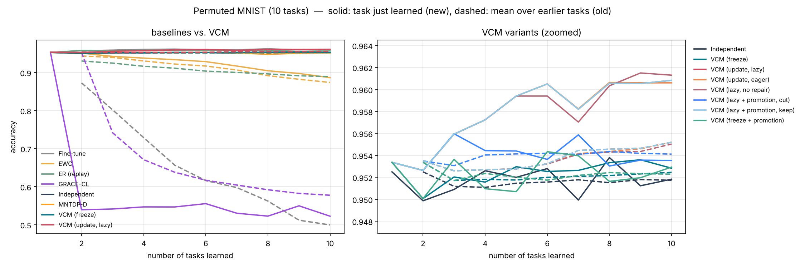
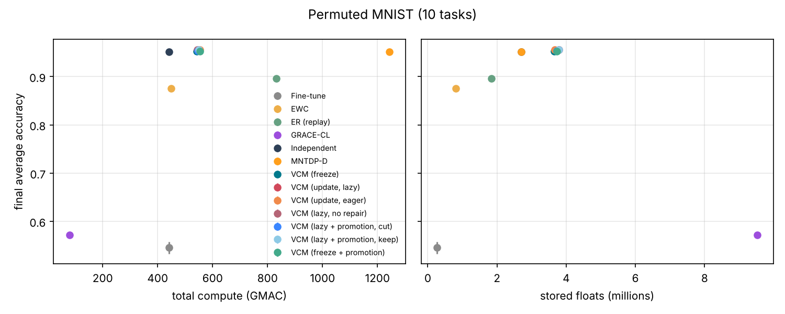

# Permuted MNIST (10 tasks)

参数：`{'benchmark': 'pmnist', 'tasks': 10, 'train_per_task': None, 'keep_first_full': False, 'eval_split': 'test', 'epochs': None, 'batch_size': 128, 'lr': 0.001, 'buffer': 200, 'ewc_lambda': 100.0, 'grace_eps': 1.0, 'grace_keys': 2000, 'shared_lr_scale': 0.1, 'tolerance': 0.02, 'serve_batches': 20, 'threads': 1, 'tag': ''}`，每任务 epoch = 1。

## 汇总（均值 ± 标准差，跨种子）

| 方法 | 种子数 | 最终平均准确率 ACC | 学习准确率 LA | 前向迁移 FWT | BWT | 遗忘 | 计算量 (GMAC) | 参数 (M) | 缓冲等 (M) |
|---|---|---|---|---|---|---|---|---|---|
| Fine-tune | 3 | 0.546 ± 0.012 | 0.959 ± 0.000 | 0.008 ± 0.001 | -0.460 ± 0.014 | 0.460 ± 0.014 | 440.8 | 0.27 | 0.00 |
| EWC | 3 | 0.875 ± 0.006 | 0.925 ± 0.002 | -0.030 ± 0.002 | -0.056 ± 0.008 | 0.056 ± 0.009 | 448.9 | 0.27 | 0.54 |
| ER (replay) | 3 | 0.896 ± 0.005 | 0.957 ± 0.000 | 0.006 ± 0.000 | -0.068 ± 0.005 | 0.068 ± 0.005 | 832.7 | 0.27 | 1.57 |
| GRACE-CL | 3 | 0.572 ± 0.004 | 0.581 ± 0.003 | -0.412 ± 0.004 | -0.010 ± 0.001 | 0.010 ± 0.001 | 78.8 ± 0.3 | 0.27 | 9.25 |
| Independent | 3 | 0.952 ± 0.000 | 0.952 ± 0.000 | 0.000 | 0.000 | 0.000 | 440.8 | 2.69 | 0.01 |
| MNTDP-D | 3 | 0.951 ± 0.000 | 0.951 ± 0.000 | -0.001 ± 0.000 | 0.000 | 0.000 | 1243.8 | 2.69 | 0.01 |
| VCM (freeze) | 3 | 0.952 ± 0.001 | 0.952 ± 0.001 | 0.001 ± 0.001 | 0.000 | 0.000 | 541.7 | 2.08 | 1.58 ± 0.00 |
| VCM (update, lazy) | 3 | 0.956 ± 0.000 | 0.958 ± 0.000 | 0.007 ± 0.000 | -0.002 ± 0.000 | 0.003 ± 0.000 | 550.6 ± 9.8 | 2.21 | 1.58 ± 0.00 |
| VCM (update, eager) | 3 | 0.956 ± 0.000 | 0.958 ± 0.000 | 0.007 ± 0.000 | -0.002 ± 0.000 | 0.003 ± 0.000 | 554.4 ± 14.6 | 2.10 ± 0.03 | 1.58 ± 0.00 |
| VCM (lazy, no repair) | 3 | 0.956 ± 0.000 | 0.958 ± 0.000 | 0.007 ± 0.000 | -0.002 ± 0.000 | 0.003 ± 0.000 | 543.7 | 2.21 | 1.58 ± 0.00 |
| VCM (lazy + promotion, cut) | 3 | 0.954 ± 0.000 | 0.954 ± 0.001 | 0.002 ± 0.001 | 0.000 ± 0.000 | 0.000 ± 0.000 | 547.1 | 2.15 | 1.58 ± 0.00 |
| VCM (lazy + promotion, keep) | 3 | 0.956 ± 0.000 | 0.958 ± 0.000 | 0.007 ± 0.000 | -0.002 ± 0.000 | 0.003 ± 0.000 | 550.6 ± 9.8 | 2.21 | 1.58 ± 0.00 |
| VCM (freeze + promotion) | 3 | 0.952 ± 0.000 | 0.952 ± 0.000 | 0.001 ± 0.001 | 0.000 | 0.000 | 554.3 ± 10.2 | 2.15 | 1.58 ± 0.00 |

- ACC：学完全部任务后在所有任务上的平均准确率；LA：每个任务刚学完时的准确率均值；FWT：第 2 个任务起，刚学完时的准确率减去同种子 Independent（每任务一个全新网络）的对应值，再取均值；BWT：最终准确率减去刚学完时准确率的均值（负数 = 遗忘）；遗忘：各旧任务历史最高准确率与最终准确率之差的均值。
- 计算量按乘加次数估计（一次训练样本 ≈ 3 次前向），包括训练、探测、维护（版本检查后的验证与修复）、服务查询。
- 参数：所有保留的参数（VCM 含被钉住的旧快照与晋升出的概念副本）；缓冲等：回放/反馈缓冲区、Fisher 与锚点、GRACE 码本、任务质心等，单位百万个浮点数。

## VCM 内部统计

- **VCM (freeze)**: accept=0.00, repair=0.00, keep=0.00, maintenance_gmac=0.54, probe_gmac=7.26, retained_snapshots=0.00, concepts=0.00, router_acc=1.00；方案分布 scratch×3, top1×27
- **VCM (update, lazy)**: accept=36.67 ± 1.89, repair=0.00, keep=1.33 ± 1.89, maintenance_gmac=9.49 ± 9.77, probe_gmac=7.26, retained_snapshots=4.00, concepts=0.00, router_acc=1.00；方案分布 scratch×3, top1×27
- **VCM (update, eager)**: accept=43.00 ± 2.83, repair=0.00, keep=2.00 ± 2.83, maintenance_gmac=13.31 ± 14.65, probe_gmac=7.26, retained_snapshots=0.67 ± 0.94, concepts=0.00, router_acc=1.00；方案分布 scratch×3, top1×27
- **VCM (lazy, no repair)**: accept=36.67 ± 1.89, repair=0.00, keep=1.33 ± 1.89, maintenance_gmac=2.58, probe_gmac=7.26, retained_snapshots=4.00, concepts=0.00, router_acc=1.00；方案分布 scratch×3, top1×27
- **VCM (lazy + promotion, cut)**: accept=1.00, repair=0.00, keep=0.00, maintenance_gmac=0.59, probe_gmac=7.53, retained_snapshots=0.00, concepts=1.00, router_acc=1.00；方案分布 concept×24, scratch×3, top1×3
- **VCM (lazy + promotion, keep)**: accept=36.67 ± 1.89, repair=0.00, keep=1.33 ± 1.89, maintenance_gmac=9.49 ± 9.77, probe_gmac=7.26, retained_snapshots=4.00, concepts=1.00, router_acc=1.00；方案分布 concept×24, scratch×3, top1×3
- **VCM (freeze + promotion)**: accept=0.00, repair=0.00, keep=0.00, maintenance_gmac=0.54, probe_gmac=7.88 ± 0.51, retained_snapshots=0.00, concepts=1.00, router_acc=1.00；方案分布 concept×20, scratch×3, top1×7

