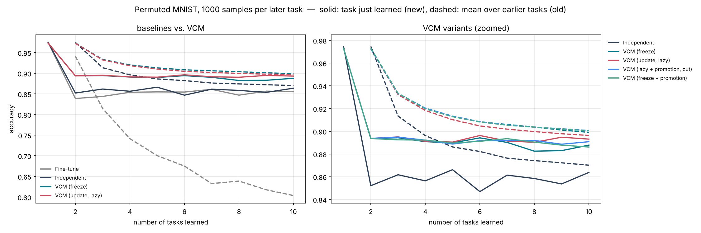
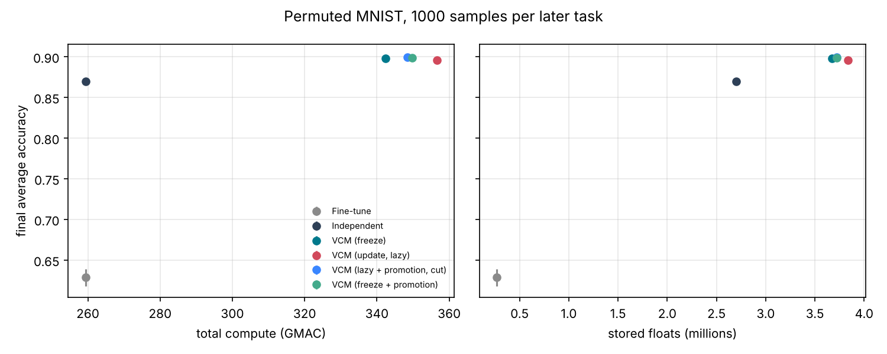

# Permuted MNIST, 1000 samples per later task

参数：`{'benchmark': 'pmnist', 'tasks': 10, 'train_per_task': 1000, 'keep_first_full': True, 'eval_split': 'test', 'epochs': 5, 'batch_size': 128, 'lr': 0.001, 'buffer': 200, 'ewc_lambda': 100.0, 'grace_eps': 1.0, 'grace_keys': 2000, 'shared_lr_scale': 0.1, 'tolerance': 0.02, 'serve_batches': 20, 'threads': 1, 'tag': 'few'}`，每任务 epoch = 5。

## 汇总（均值 ± 标准差，跨种子）

| 方法 | 种子数 | 最终平均准确率 ACC | 学习准确率 LA | 前向迁移 FWT | BWT | 遗忘 | 计算量 (GMAC) | 参数 (M) | 缓冲等 (M) |
|---|---|---|---|---|---|---|---|---|---|
| Fine-tune | 3 | 0.629 ± 0.010 | 0.864 ± 0.003 | -0.006 ± 0.005 | -0.261 ± 0.008 | 0.261 ± 0.008 | 259.4 | 0.27 | 0.00 |
| Independent | 3 | 0.870 ± 0.002 | 0.870 ± 0.002 | 0.000 | 0.000 | 0.000 | 259.4 | 2.69 | 0.01 |
| VCM (freeze) | 3 | 0.898 ± 0.002 | 0.898 ± 0.002 | 0.032 ± 0.004 | 0.000 | 0.000 | 342.4 | 2.10 ± 0.03 | 1.58 ± 0.00 |
| VCM (update, lazy) | 3 | 0.896 ± 0.003 | 0.901 ± 0.002 | 0.035 ± 0.004 | -0.005 ± 0.001 | 0.006 ± 0.001 | 356.6 ± 2.4 | 2.26 ± 0.03 | 1.58 ± 0.00 |
| VCM (lazy + promotion, cut) | 3 | 0.900 ± 0.001 | 0.900 ± 0.001 | 0.034 ± 0.004 | -0.000 ± 0.000 | 0.000 ± 0.000 | 348.4 ± 2.1 | 2.15 | 1.58 ± 0.00 |
| VCM (freeze + promotion) | 3 | 0.899 ± 0.001 | 0.899 ± 0.001 | 0.033 ± 0.004 | 0.000 | 0.000 | 349.8 ± 4.1 | 2.15 | 1.58 ± 0.00 |

- ACC：学完全部任务后在所有任务上的平均准确率；LA：每个任务刚学完时的准确率均值；FWT：第 2 个任务起，刚学完时的准确率减去同种子 Independent（每任务一个全新网络）的对应值，再取均值；BWT：最终准确率减去刚学完时准确率的均值（负数 = 遗忘）；遗忘：各旧任务历史最高准确率与最终准确率之差的均值。
- 计算量按乘加次数估计（一次训练样本 ≈ 3 次前向），包括训练、探测、维护（版本检查后的验证与修复）、服务查询。
- 参数：所有保留的参数（VCM 含被钉住的旧快照与晋升出的概念副本）；缓冲等：回放/反馈缓冲区、Fisher 与锚点、GRACE 码本、任务质心等，单位百万个浮点数。

## VCM 内部统计

- **VCM (freeze)**: accept=0.00, repair=0.00, keep=0.00, maintenance_gmac=0.54, probe_gmac=7.26, retained_snapshots=0.00, concepts=0.00, router_acc=1.00；方案分布 scratch×3, top1×26, top2×1
- **VCM (update, lazy)**: accept=35.67 ± 0.47, repair=0.00, keep=2.33 ± 0.47, maintenance_gmac=14.66 ± 2.44, probe_gmac=7.26, retained_snapshots=5.33 ± 0.94, concepts=0.00, router_acc=1.00；方案分布 scratch×3, top1×27
- **VCM (lazy + promotion, cut)**: accept=1.67 ± 0.94, repair=0.00, keep=0.00, maintenance_gmac=0.63 ± 0.05, probe_gmac=7.62 ± 0.13, retained_snapshots=0.00, concepts=1.00, router_acc=1.00；方案分布 concept×23, scratch×3, top1×4
- **VCM (freeze + promotion)**: accept=0.00, repair=0.00, keep=0.00, maintenance_gmac=0.54, probe_gmac=7.71 ± 0.25, retained_snapshots=0.00, concepts=1.00, router_acc=1.00；方案分布 concept×22, scratch×3, top1×5

