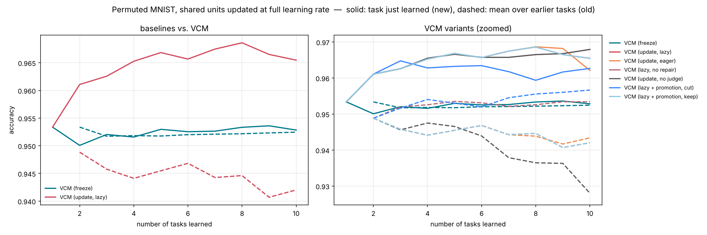
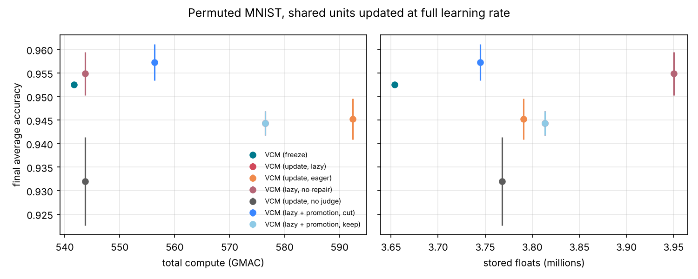

# Permuted MNIST, shared units updated at full learning rate

参数：`{'benchmark': 'pmnist', 'tasks': 10, 'train_per_task': None, 'keep_first_full': False, 'eval_split': 'test', 'epochs': None, 'batch_size': 128, 'lr': 0.001, 'buffer': 200, 'ewc_lambda': 100.0, 'grace_eps': 1.0, 'grace_keys': 2000, 'shared_lr_scale': 1.0, 'tolerance': 0.02, 'serve_batches': 20, 'threads': 1, 'tag': 'stress'}`，每任务 epoch = 1。

## 汇总（均值 ± 标准差，跨种子）

| 方法 | 种子数 | 最终平均准确率 ACC | 学习准确率 LA | 前向迁移 FWT | BWT | 遗忘 | 计算量 (GMAC) | 参数 (M) | 缓冲等 (M) |
|---|---|---|---|---|---|---|---|---|---|
| VCM (freeze) | 3 | 0.952 ± 0.001 | 0.952 ± 0.001 | 0.001 ± 0.001 | 0.000 | 0.000 | 541.7 | 2.08 | 1.58 ± 0.00 |
| VCM (update, lazy) | 3 | 0.944 ± 0.003 | 0.964 ± 0.001 | 0.014 ± 0.001 | -0.022 ± 0.003 | 0.023 ± 0.003 | 576.5 ± 4.9 | 2.24 ± 0.03 | 1.58 ± 0.00 |
| VCM (update, eager) | 3 | 0.945 ± 0.004 | 0.964 ± 0.000 | 0.014 ± 0.000 | -0.021 ± 0.005 | 0.021 ± 0.005 | 592.4 ± 8.8 | 2.21 | 1.58 ± 0.00 |
| VCM (lazy, no repair) | 3 | 0.955 ± 0.005 | 0.964 ± 0.001 | 0.014 ± 0.000 | -0.010 ± 0.006 | 0.011 ± 0.006 | 543.7 | 2.37 ± 0.03 | 1.58 ± 0.00 |
| VCM (update, no judge) | 3 | 0.932 ± 0.009 | 0.964 ± 0.001 | 0.014 ± 0.000 | -0.036 ± 0.011 | 0.036 ± 0.011 | 543.7 | 2.19 ± 0.03 | 1.58 ± 0.00 |
| VCM (lazy + promotion, cut) | 3 | 0.957 ± 0.004 | 0.961 ± 0.001 | 0.011 ± 0.002 | -0.005 ± 0.006 | 0.005 ± 0.006 | 556.4 ± 13.0 | 2.17 ± 0.03 | 1.58 ± 0.00 |
| VCM (lazy + promotion, keep) | 3 | 0.944 ± 0.003 | 0.964 ± 0.001 | 0.014 ± 0.001 | -0.022 ± 0.003 | 0.023 ± 0.003 | 576.5 ± 4.9 | 2.24 ± 0.03 | 1.58 ± 0.00 |

- ACC：学完全部任务后在所有任务上的平均准确率；LA：每个任务刚学完时的准确率均值；FWT：第 2 个任务起，刚学完时的准确率减去同种子 Independent（每任务一个全新网络）的对应值，再取均值；BWT：最终准确率减去刚学完时准确率的均值（负数 = 遗忘）；遗忘：各旧任务历史最高准确率与最终准确率之差的均值。
- 计算量按乘加次数估计（一次训练样本 ≈ 3 次前向），包括训练、探测、维护（版本检查后的验证与修复）、服务查询。
- 参数：所有保留的参数（VCM 含被钉住的旧快照与晋升出的概念副本）；缓冲等：回放/反馈缓冲区、Fisher 与锚点、GRACE 码本、任务质心等，单位百万个浮点数。

## VCM 内部统计

- **VCM (freeze)**: accept=0.00, repair=0.00, keep=0.00, maintenance_gmac=0.54, probe_gmac=7.26, retained_snapshots=0.00, concepts=0.00, router_acc=1.00；方案分布 scratch×3, top1×27
- **VCM (update, lazy)**: accept=31.67 ± 0.94, repair=2.33 ± 0.94, keep=4.00, maintenance_gmac=35.38 ± 4.88, probe_gmac=7.26, retained_snapshots=4.67 ± 0.94, concepts=0.00, router_acc=1.00；方案分布 scratch×3, top1×27
- **VCM (update, eager)**: accept=35.67 ± 1.70, repair=2.67 ± 1.25, keep=6.67 ± 0.94, maintenance_gmac=51.29 ± 8.80, probe_gmac=7.26, retained_snapshots=4.00, concepts=0.00, router_acc=1.00；方案分布 scratch×3, top1×27
- **VCM (lazy, no repair)**: accept=26.00 ± 0.82, repair=0.00, keep=12.00 ± 0.82, maintenance_gmac=2.58, probe_gmac=7.26, retained_snapshots=8.67 ± 0.94, concepts=0.00, router_acc=1.00；方案分布 scratch×3, top1×27
- **VCM (update, no judge)**: accept=38.00, repair=0.00, keep=0.00, maintenance_gmac=2.58, probe_gmac=7.26, retained_snapshots=3.33 ± 0.94, concepts=0.00, router_acc=1.00；方案分布 scratch×3, top1×27
- **VCM (lazy + promotion, cut)**: accept=5.33 ± 6.13, repair=0.00, keep=0.33 ± 0.47, maintenance_gmac=2.57 ± 2.80, probe_gmac=7.88 ± 0.51, retained_snapshots=0.67 ± 0.94, concepts=1.00, router_acc=1.00；方案分布 concept×20, scratch×3, top1×7
- **VCM (lazy + promotion, keep)**: accept=31.67 ± 0.94, repair=2.33 ± 0.94, keep=4.00, maintenance_gmac=35.38 ± 4.88, probe_gmac=7.26, retained_snapshots=4.67 ± 0.94, concepts=1.00, router_acc=1.00；方案分布 concept×24, scratch×3, top1×3

