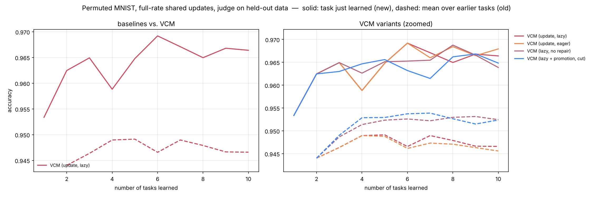
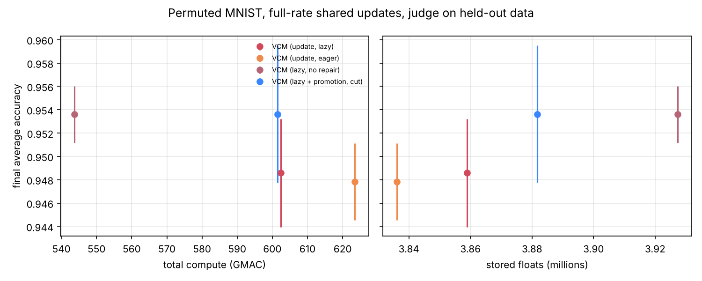

# Permuted MNIST, full-rate shared updates, judge on held-out data

参数：`{'benchmark': 'pmnist', 'tasks': 10, 'train_per_task': None, 'keep_first_full': False, 'eval_split': 'test', 'epochs': None, 'batch_size': 128, 'lr': 0.001, 'buffer': 200, 'ewc_lambda': 100.0, 'grace_eps': 1.0, 'grace_keys': 2000, 'shared_lr_scale': 1.0, 'tolerance': 0.02, 'feedback_source': 'val', 'serve_batches': 20, 'threads': 1, 'tag': 'stress_val'}`，每任务 epoch = 1。

## 汇总（均值 ± 标准差，跨种子）

| 方法 | 种子数 | 最终平均准确率 ACC | 学习准确率 LA | 前向迁移 FWT | BWT | 遗忘 | 计算量 (GMAC) | 参数 (M) | 缓冲等 (M) |
|---|---|---|---|---|---|---|---|---|---|
| VCM (update, lazy) | 3 | 0.949 ± 0.005 | 0.964 ± 0.001 | 0.013 ± 0.001 | -0.017 ± 0.006 | 0.017 ± 0.006 | 602.4 ± 21.3 | 2.28 | 1.58 ± 0.00 |
| VCM (update, eager) | 3 | 0.948 ± 0.003 | 0.964 ± 0.001 | 0.014 ± 0.001 | -0.018 ± 0.005 | 0.018 ± 0.005 | 623.5 ± 20.0 | 2.26 ± 0.03 | 1.58 ± 0.00 |
| VCM (lazy, no repair) | 3 | 0.954 ± 0.002 | 0.964 ± 0.001 | 0.013 ± 0.001 | -0.011 ± 0.002 | 0.012 ± 0.002 | 543.7 | 2.35 ± 0.06 | 1.58 ± 0.00 |
| VCM (lazy + promotion, cut) | 3 | 0.954 ± 0.006 | 0.963 ± 0.002 | 0.013 ± 0.002 | -0.011 ± 0.008 | 0.011 ± 0.008 | 601.4 ± 40.4 | 2.31 ± 0.12 | 1.58 ± 0.00 |

- ACC：学完全部任务后在所有任务上的平均准确率；LA：每个任务刚学完时的准确率均值；FWT：第 2 个任务起，刚学完时的准确率减去同种子 Independent（每任务一个全新网络）的对应值，再取均值；BWT：最终准确率减去刚学完时准确率的均值（负数 = 遗忘）；遗忘：各旧任务历史最高准确率与最终准确率之差的均值。
- 计算量按乘加次数估计（一次训练样本 ≈ 3 次前向），包括训练、探测、维护（版本检查后的验证与修复）、服务查询。
- 参数：所有保留的参数（VCM 含被钉住的旧快照与晋升出的概念副本）；缓冲等：回放/反馈缓冲区、Fisher 与锚点、GRACE 码本、任务质心等，单位百万个浮点数。

## VCM 内部统计

- **VCM (update, lazy)**: accept=26.67 ± 4.11, repair=1.67 ± 0.94, keep=9.67 ± 4.99, maintenance_gmac=61.28 ± 21.28, probe_gmac=7.26, retained_snapshots=6.00, concepts=0.00, router_acc=1.00；方案分布 scratch×3, top1×27
- **VCM (update, eager)**: accept=29.67 ± 3.86, repair=2.33 ± 1.25, keep=13.00 ± 4.97, maintenance_gmac=82.37 ± 19.98, probe_gmac=7.26, retained_snapshots=5.33 ± 0.94, concepts=0.00, router_acc=1.00；方案分布 scratch×3, top1×27
- **VCM (lazy, no repair)**: accept=21.67 ± 2.62, repair=0.00, keep=16.33 ± 2.62, maintenance_gmac=2.58, probe_gmac=7.26, retained_snapshots=8.00 ± 1.63, concepts=0.00, router_acc=1.00；方案分布 scratch×3, top1×27
- **VCM (lazy + promotion, cut)**: accept=20.33 ± 13.89, repair=0.67 ± 0.94, keep=4.67 ± 4.64, maintenance_gmac=29.54 ± 24.08, probe_gmac=8.78 ± 0.89, retained_snapshots=4.67 ± 3.40, concepts=1.00, router_acc=1.00；方案分布 concept×8, scratch×3, top1×19

