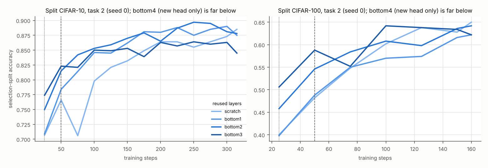

# Split CIFAR 上的候选选择：在学习曲线上重放（验证集）

VCM（freeze）每个决策的所有候选都训满，每 25 步记录选择集与留出集准确率（诊断运行留出训练池的 20%：选择集大小与学习器实际用的相同，CIFAR-10 1000 张、CIFAR-100 500 张，其余做留出集）。各规则只看选择集、只看它付过费的步数；所选候选按训满后在留出集上的准确率计分。“遗憾” = 天花板（按留出集挑）− 所选；“计算” = 候选训练步数之和，相对“探测 50 步”（CIFAR 的默认）；“对探测 50”= 逐决策配对差的均值，括号里是按种子平均后为正 / 为负的种子数；“补回” = (规则 − 探测 50) / (训满 − 探测 50)。测试集上跑哪两条规则，是看完本页之前定好的标准选的：与探测 50 同价的逐步淘汰（所问的问题本身），以及计算不超过 1.5 倍的规则里两个基准平均增益最大的一条（top-2 after 25）。标 (post hoc) 的规则是看过测试集结果之后才加的，只在这里看，没有上测试集。

## Split CIFAR-10（8 个种子，32 个决策）

| 规则 | 留出集准确率 | 遗憾 | 计算 | 对探测 50 | 补回 | 所选方案 |
|---|---|---|---|---|---|---|
| probe 25 | 0.8912 | 0.0225 | 0.81 | -0.0008（1+ / 5−） | -4% | bottom1×1, bottom2×7, bottom3×24 |
| probe 50 | 0.8920 | 0.0217 | 1.00 | +0.0000（0+ / 0−） | 0% | bottom1×1, bottom2×11, bottom3×20 |
| probe 100 | 0.8991 | 0.0146 | 1.39 | +0.0071（7+ / 1−） | 39% | bottom1×1, bottom2×17, bottom3×13, scratch×1 |
| probe 50, no parsimony | 0.8945 | 0.0192 | 1.00 | +0.0025（3+ / 0−） | 14% | bottom1×1, bottom2×14, bottom3×17 |
| halving 25 x2 | 0.8983 | 0.0154 | 1.00 | +0.0063（6+ / 2−） | 34% | bottom1×2, bottom2×15, bottom3×15 |
| halving 25 x3 | 0.8973 | 0.0163 | 0.90 | +0.0053（6+ / 1−） | 29% | bottom1×2, bottom2×15, bottom3×15 |
| halving 50 x2 | 0.9044 | 0.0092 | 1.39 | +0.0124（8+ / 0−） | 68% | bottom1×5, bottom2×20, bottom3×5, scratch×2 |
| race 25, margin 0.02 | 0.8987 | 0.0150 | 1.18 | +0.0067（6+ / 1−） | 36% | bottom1×2, bottom2×14, bottom3×14, scratch×2 |
| race 50, margin 0.01 | 0.8973 | 0.0164 | 1.21 | +0.0053（6+ / 0−） | 29% | bottom1×2, bottom2×18, bottom3×12 |
| race 50, margin 0.02 | 0.9005 | 0.0132 | 1.47 | +0.0085（8+ / 0−） | 46% | bottom1×3, bottom2×15, bottom3×9, scratch×5 |
| top-2 after 25 | 0.9063 | 0.0073 | 1.37 | +0.0143（8+ / 0−） | 78% | bottom1×6, bottom2×23, bottom3×3 |
| top-2 after 50 | 0.9057 | 0.0080 | 1.51 | +0.0137（8+ / 0−） | 75% | bottom1×2, bottom2×25, bottom3×3, scratch×2 |
| top-3 after 25 (post hoc) | 0.9077 | 0.0059 | 1.93 | +0.0157（8+ / 0−） | 86% | bottom1×6, bottom2×21, scratch×5 |
| full | 0.9103 | 0.0033 | 3.06 | +0.0183（8+ / 0−） | 100% | bottom1×11, bottom2×16, scratch×5 |
| full, no parsimony | 0.9099 | 0.0038 | 3.06 | +0.0179（8+ / 0−） | 98% | bottom1×15, bottom2×7, scratch×10 |
| oracle (held-out) | 0.9137 | 0.0000 | 3.06 | +0.0217（8+ / 0−） | 118% | bottom1×14, bottom2×11, scratch×7 |

“全部训满”最终选中的候选，在第 k 步时于选择集上排第几（32 个决策；总预算 315 步）：

| 步数 | 第 1 | 前 2 | 前 3 |
|---|---|---|---|
| 25 | 19% | 41% | 84% |
| 50 | 22% | 50% | 94% |
| 100 | 38% | 69% | 75% |
| 200 | 44% | 69% | 91% |

第 25 步时选择集上的前两名（即“top-2 after 25”的决赛名单）：bottom2 + bottom3 25 次，bottom1 + bottom3 6 次，bottom1 + bottom2 1 次。

## Split CIFAR-100（8 个种子，72 个决策）

| 规则 | 留出集准确率 | 遗憾 | 计算 | 对探测 50 | 补回 | 所选方案 |
|---|---|---|---|---|---|---|
| probe 25 | 0.6426 | 0.0151 | 0.72 | +0.0000（1+ / 0−） | 0% | bottom3×72 |
| probe 50 | 0.6426 | 0.0152 | 1.00 | +0.0000（0+ / 0−） | 0% | bottom2×1, bottom3×71 |
| probe 100 | 0.6444 | 0.0134 | 1.56 | +0.0018（4+ / 2−） | 19% | bottom2×21, bottom3×50, scratch×1 |
| probe 50, no parsimony | 0.6427 | 0.0151 | 1.00 | +0.0001（1+ / 0−） | 1% | bottom2×2, bottom3×70 |
| halving 25 x2 | 0.6441 | 0.0136 | 1.00 | +0.0015（4+ / 2−） | 16% | bottom1×1, bottom2×20, bottom3×51 |
| halving 25 x3 | 0.6442 | 0.0136 | 0.86 | +0.0016（6+ / 1−） | 17% | bottom2×14, bottom3×58 |
| halving 50 x2 | 0.6477 | 0.0101 | 1.44 | +0.0051（7+ / 1−） | 55% | bottom1×3, bottom2×29, bottom3×36, scratch×4 |
| race 25, margin 0.02 | 0.6433 | 0.0144 | 0.75 | +0.0007（2+ / 0−） | 8% | bottom2×3, bottom3×69 |
| race 50, margin 0.01 | 0.6432 | 0.0146 | 1.03 | +0.0006（2+ / 0−） | 7% | bottom2×3, bottom3×69 |
| race 50, margin 0.02 | 0.6445 | 0.0133 | 1.08 | +0.0019（4+ / 1−） | 21% | bottom2×9, bottom3×63 |
| top-2 after 25 | 0.6494 | 0.0084 | 1.10 | +0.0068（8+ / 0−） | 73% | bottom1×1, bottom2×34, bottom3×37 |
| top-2 after 50 | 0.6496 | 0.0082 | 1.31 | +0.0070（8+ / 0−） | 75% | bottom1×1, bottom2×34, bottom3×37 |
| top-3 after 25 (post hoc) | 0.6516 | 0.0062 | 1.47 | +0.0090（8+ / 0−） | 97% | bottom1×10, bottom2×30, bottom3×29, scratch×3 |
| full | 0.6519 | 0.0059 | 2.22 | +0.0093（8+ / 0−） | 100% | bottom1×13, bottom2×25, bottom3×26, scratch×8 |
| full, no parsimony | 0.6503 | 0.0075 | 2.22 | +0.0077（8+ / 0−） | 83% | bottom1×14, bottom2×27, bottom3×22, scratch×9 |
| oracle (held-out) | 0.6578 | 0.0000 | 2.22 | +0.0152（8+ / 0−） | 163% | bottom1×15, bottom2×26, bottom3×20, scratch×11 |

“全部训满”最终选中的候选，在第 k 步时于选择集上排第几（72 个决策；总预算 160 步）：

| 步数 | 第 1 | 前 2 | 前 3 |
|---|---|---|---|
| 25 | 38% | 72% | 88% |
| 50 | 36% | 71% | 86% |
| 100 | 38% | 65% | 85% |

第 25 步时选择集上的前两名（即“top-2 after 25”的决赛名单）：bottom2 + bottom3 66 次，bottom1 + bottom3 4 次，bottom3 + scratch 2 次。

