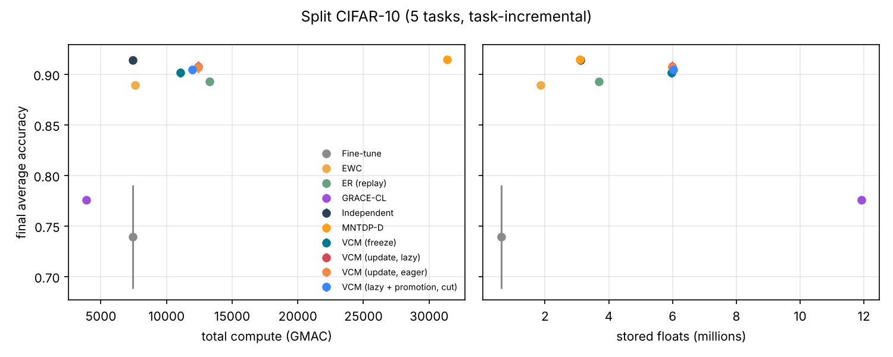

# Split CIFAR-10 (5 tasks, task-incremental)

参数：`{'benchmark': 'split_cifar10', 'tasks': None, 'train_per_task': None, 'keep_first_full': False, 'eval_split': 'test', 'epochs': None, 'batch_size': 128, 'lr': 0.001, 'buffer': 200, 'ewc_lambda': 100.0, 'grace_eps': 1.0, 'grace_keys': 2000, 'shared_lr_scale': 0.1, 'tolerance': 0.02, 'feedback_source': 'train', 'serve_batches': 20, 'threads': 1, 'tag': ''}`，每任务 epoch = 5。

## 汇总（均值 ± 标准差，跨种子）

| 方法 | 种子数 | 最终平均准确率 ACC | 学习准确率 LA | 前向迁移 FWT | BWT | 遗忘 | 计算量 (GMAC) | 参数 (M) | 缓冲等 (M) |
|---|---|---|---|---|---|---|---|---|---|
| Fine-tune | 3 | 0.739 ± 0.051 | 0.923 ± 0.002 | 0.011 ± 0.003 | -0.229 ± 0.063 | 0.229 ± 0.063 | 7430.0 | 0.62 | 0.00 |
| EWC | 3 | 0.889 ± 0.001 | 0.906 ± 0.004 | -0.010 ± 0.005 | -0.021 ± 0.006 | 0.021 ± 0.006 | 7592.7 | 0.62 | 1.24 |
| ER (replay) | 3 | 0.893 ± 0.003 | 0.917 ± 0.007 | 0.004 ± 0.008 | -0.030 ± 0.009 | 0.032 ± 0.007 | 13287.2 ± 0.0 | 0.62 | 3.07 ± 0.00 |
| GRACE-CL | 3 | 0.776 ± 0.002 | 0.776 ± 0.002 | -0.173 ± 0.003 | 0.000 | 0.000 | 3916.4 ± 0.0 | 0.62 | 11.31 ± 0.13 |
| Independent | 3 | 0.914 ± 0.001 | 0.914 ± 0.001 | 0.000 | 0.000 | 0.000 | 7430.0 | 3.09 ± 0.00 | 0.02 |
| MNTDP-D | 3 | 0.915 ± 0.003 | 0.915 ± 0.003 | 0.003 ± 0.003 | 0.000 | 0.000 | 31379.1 ± 0.0 | 3.08 ± 0.01 | 0.02 |
| VCM (freeze) | 3 | 0.901 ± 0.004 | 0.901 ± 0.004 | -0.014 ± 0.006 | 0.000 | 0.000 | 11061.5 ± 0.0 | 2.87 ± 0.05 | 3.09 |
| VCM (update, lazy) | 3 | 0.907 ± 0.005 | 0.913 ± 0.003 | 0.001 ± 0.003 | -0.007 ± 0.009 | 0.008 ± 0.008 | 12406.7 ± 394.1 | 2.90 ± 0.07 | 3.09 |
| VCM (update, eager) | 3 | 0.907 ± 0.005 | 0.913 ± 0.003 | 0.001 ± 0.003 | -0.007 ± 0.009 | 0.008 ± 0.008 | 12406.7 ± 394.1 | 2.90 ± 0.07 | 3.09 |
| VCM (lazy + promotion, cut) | 3 | 0.905 ± 0.003 | 0.907 ± 0.001 | -0.007 ± 0.001 | -0.002 ± 0.004 | 0.004 ± 0.002 | 11985.9 ± 525.2 | 2.94 ± 0.04 | 3.09 |

- ACC：学完全部任务后在所有任务上的平均准确率；LA：每个任务刚学完时的准确率均值；FWT：第 2 个任务起，刚学完时的准确率减去同种子 Independent（每任务一个全新网络）的对应值，再取均值；BWT：最终准确率减去刚学完时准确率的均值（负数 = 遗忘）；遗忘：各旧任务历史最高准确率与最终准确率之差的均值。
- 计算量按乘加次数估计（一次训练样本 ≈ 3 次前向），包括训练、探测、维护（版本检查后的验证与修复）、服务查询。
- 参数：所有保留的参数（VCM 含被钉住的旧快照与晋升出的概念副本）；缓冲等：回放/反馈缓冲区、Fisher 与锚点、GRACE 码本、任务质心等，单位百万个浮点数。

## VCM 内部统计

- **VCM (freeze)**: accept=0.00, repair=0.00, keep=0.00, maintenance_gmac=10.85, probe_gmac=216.93, retained_snapshots=0.00, concepts=0.00；方案分布 bottom2×5, bottom3×6, scratch×4
- **VCM (update, lazy)**: accept=3.67 ± 1.89, repair=1.00 ± 0.82, keep=5.33 ± 2.05, maintenance_gmac=1356.10 ± 394.06, probe_gmac=216.93, retained_snapshots=4.00 ± 1.63, concepts=0.00；方案分布 bottom2×4, bottom3×8, scratch×3
- **VCM (update, eager)**: accept=3.67 ± 1.89, repair=1.00 ± 0.82, keep=5.33 ± 2.05, maintenance_gmac=1356.10 ± 394.06, probe_gmac=216.93, retained_snapshots=4.00 ± 1.63, concepts=0.00；方案分布 bottom2×4, bottom3×8, scratch×3
- **VCM (lazy + promotion, cut)**: accept=4.33 ± 0.94, repair=0.33 ± 0.47, keep=4.00 ± 2.45, maintenance_gmac=935.24 ± 525.16, probe_gmac=216.93, retained_snapshots=3.67 ± 1.70, concepts=1.33 ± 0.47；方案分布 bottom2×1, bottom3×10, concept×1, scratch×3

