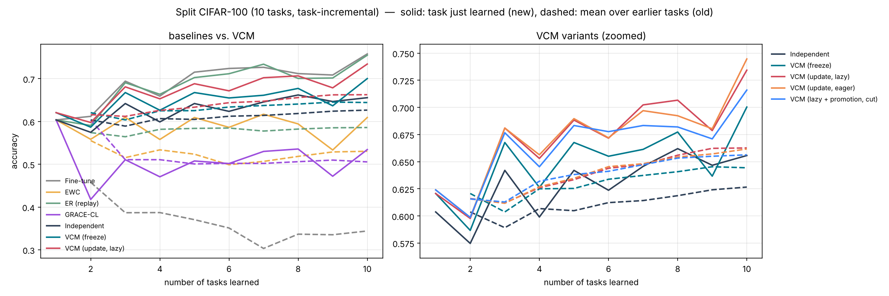
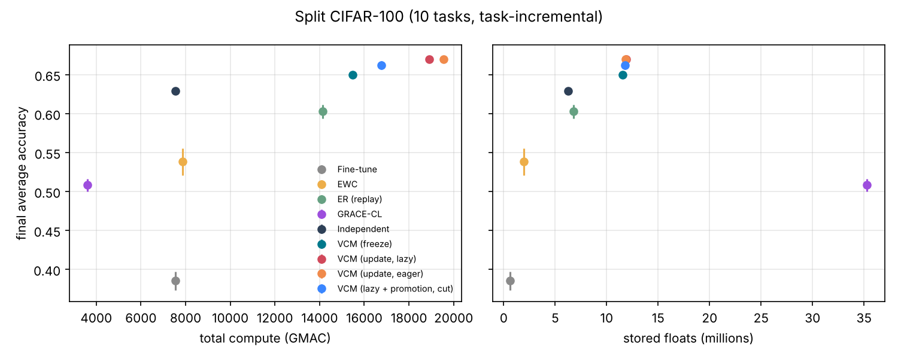

# Split CIFAR-100 (10 tasks, task-incremental)

参数：`{'benchmark': 'split_cifar100', 'tasks': None, 'train_per_task': None, 'keep_first_full': False, 'eval_split': 'test', 'epochs': None, 'batch_size': 128, 'lr': 0.001, 'buffer': 200, 'ewc_lambda': 100.0, 'grace_eps': 1.0, 'grace_keys': 2000, 'shared_lr_scale': 0.1, 'tolerance': 0.02, 'feedback_source': 'train', 'serve_batches': 20, 'threads': 1, 'tag': ''}`，每任务 epoch = 5。

## 汇总（均值 ± 标准差，跨种子）

| 方法 | 种子数 | 最终平均准确率 ACC | 学习准确率 LA | 前向迁移 FWT | BWT | 遗忘 | 计算量 (GMAC) | 参数 (M) | 缓冲等 (M) |
|---|---|---|---|---|---|---|---|---|---|
| Fine-tune | 3 | 0.385 ± 0.012 | 0.691 ± 0.008 | 0.069 ± 0.012 | -0.340 ± 0.021 | 0.340 ± 0.021 | 7539.9 ± 0.0 | 0.64 | 0.00 |
| EWC | 3 | 0.538 ± 0.018 | 0.588 ± 0.010 | -0.046 ± 0.015 | -0.055 ± 0.009 | 0.058 ± 0.009 | 7865.4 | 0.64 | 1.29 |
| ER (replay) | 3 | 0.603 ± 0.009 | 0.685 ± 0.005 | 0.062 ± 0.007 | -0.092 ± 0.005 | 0.092 ± 0.005 | 14130.5 | 0.64 | 6.14 ± 0.00 |
| GRACE-CL | 3 | 0.508 ± 0.008 | 0.508 ± 0.008 | -0.135 ± 0.011 | 0.000 | 0.000 | 3593.3 ± 0.0 | 0.64 | 34.62 ± 0.27 |
| Independent | 3 | 0.629 ± 0.004 | 0.629 ± 0.004 | 0.000 | 0.000 | 0.000 | 7539.9 ± 0.0 | 6.20 | 0.03 |
| VCM (freeze) | 3 | 0.650 ± 0.004 | 0.650 ± 0.004 | 0.021 ± 0.011 | 0.000 | 0.000 | 15480.1 | 5.39 ± 0.03 | 6.17 |
| VCM (update, lazy) | 3 | 0.670 ± 0.003 | 0.673 ± 0.002 | 0.047 ± 0.009 | -0.004 ± 0.001 | 0.008 ± 0.003 | 18906.9 ± 950.2 | 5.74 ± 0.08 | 6.17 |
| VCM (update, eager) | 3 | 0.670 ± 0.003 | 0.674 ± 0.003 | 0.047 ± 0.010 | -0.004 ± 0.001 | 0.007 ± 0.001 | 19549.2 ± 743.9 | 5.68 ± 0.09 | 6.17 |
| VCM (lazy + promotion, cut) | 3 | 0.662 ± 0.005 | 0.666 ± 0.005 | 0.038 ± 0.013 | -0.004 ± 0.003 | 0.007 ± 0.003 | 16776.2 ± 873.7 | 5.58 ± 0.09 | 6.17 |

- ACC：学完全部任务后在所有任务上的平均准确率；LA：每个任务刚学完时的准确率均值；FWT：第 2 个任务起，刚学完时的准确率减去同种子 Independent（每任务一个全新网络）的对应值，再取均值；BWT：最终准确率减去刚学完时准确率的均值（负数 = 遗忘）；遗忘：各旧任务历史最高准确率与最终准确率之差的均值。
- 计算量按乘加次数估计（一次训练样本 ≈ 3 次前向），包括训练、探测、维护（版本检查后的验证与修复）、服务查询。
- 参数：所有保留的参数（VCM 含被钉住的旧快照与晋升出的概念副本）；缓冲等：回放/反馈缓冲区、Fisher 与锚点、GRACE 码本、任务质心等，单位百万个浮点数。

## VCM 内部统计

- **VCM (freeze)**: accept=0.00, repair=0.00, keep=0.00, maintenance_gmac=21.70, probe_gmac=244.10 ± 0.00, retained_snapshots=0.00, concepts=0.00；方案分布 bottom2×1, bottom3×26, scratch×3
- **VCM (update, lazy)**: accept=22.00 ± 4.55, repair=0.00, keep=16.00 ± 4.55, maintenance_gmac=3448.52 ± 950.23, probe_gmac=244.10 ± 0.00, retained_snapshots=12.00 ± 2.45, concepts=0.00；方案分布 bottom3×27, scratch×3
- **VCM (update, eager)**: accept=26.00 ± 3.56, repair=0.00, keep=19.00 ± 3.56, maintenance_gmac=4090.78 ± 743.92, probe_gmac=244.10 ± 0.00, retained_snapshots=10.00 ± 2.83, concepts=0.00；方案分布 bottom3×27, scratch×3
- **VCM (lazy + promotion, cut)**: accept=13.33 ± 6.13, repair=0.33 ± 0.47, keep=5.67 ± 4.50, maintenance_gmac=1317.79 ± 873.73, probe_gmac=244.10 ± 0.00, retained_snapshots=4.00 ± 2.83, concepts=1.00；方案分布 bottom3×17, concept×10, scratch×3

