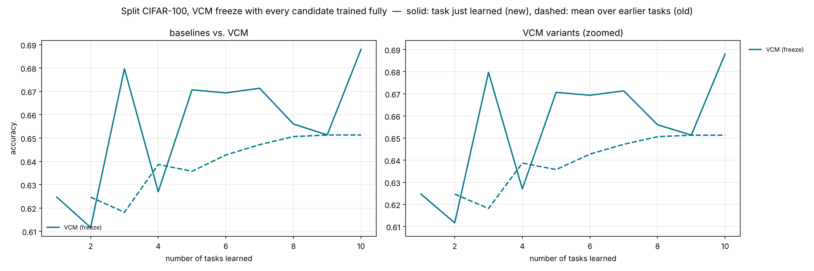
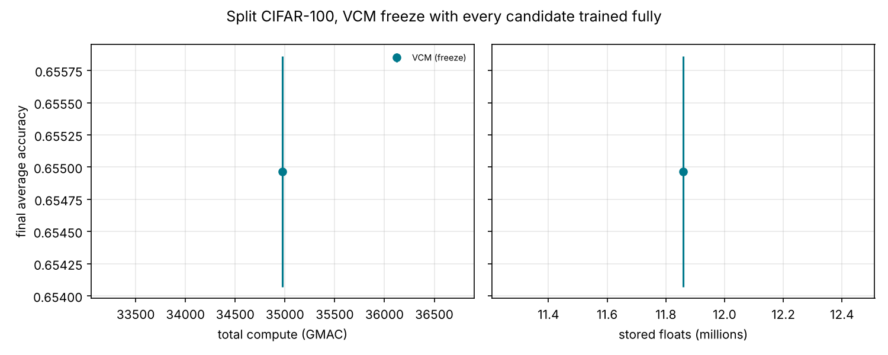

# Split CIFAR-100, VCM freeze with every candidate trained fully

参数：`{'benchmark': 'split_cifar100', 'tasks': None, 'train_per_task': None, 'keep_first_full': False, 'eval_split': 'test', 'epochs': None, 'min_steps': 0, 'batch_size': 128, 'lr': 0.001, 'buffer': 200, 'ewc_lambda': 100.0, 'grace_eps': 1.0, 'grace_keys': 2000, 'shared_lr_scale': 0.1, 'tolerance': 0.02, 'feedback_source': 'train', 'repair_steps': 100, 'probe_steps': 50, 'selection': 'full', 'halving_eta': 2, 'curve_every': 0, 'serve_batches': 20, 'threads': 2, 'tag': 'full'}`，每任务 epoch = 5。

## 汇总（均值 ± 标准差，跨种子）

| 方法 | 种子数 | 最终平均准确率 ACC | 学习准确率 LA | 前向迁移 FWT | BWT | 遗忘 | 计算量 (GMAC) | 参数 (M) | 缓冲等 (M) |
|---|---|---|---|---|---|---|---|---|---|
| VCM (freeze) | 3 | 0.655 ± 0.001 | 0.655 ± 0.001 | 0.026 ± 0.006 | 0.000 | 0.000 | 34976.6 | 5.68 ± 0.07 | 6.17 |

- ACC：学完全部任务后在所有任务上的平均准确率；LA：每个任务刚学完时的准确率均值；FWT：第 2 个任务起，刚学完时的准确率减去同种子 Independent（每任务一个全新网络）的对应值，再取均值；BWT：最终准确率减去刚学完时准确率的均值（负数 = 遗忘）；遗忘：各旧任务历史最高准确率与最终准确率之差的均值。
- 计算量按乘加次数估计（一次训练样本 ≈ 3 次前向），包括训练、探测、维护（版本检查后的验证与修复）、服务查询。
- 参数：所有保留的参数（VCM 含被钉住的旧快照与晋升出的概念副本）；缓冲等：回放/反馈缓冲区、Fisher 与锚点、GRACE 码本、任务质心等，单位百万个浮点数。

## VCM 内部统计

- **VCM (freeze)**: accept=0.00, repair=0.00, keep=0.00, maintenance_gmac=21.70, probe_gmac=244.10 ± 0.00, retained_snapshots=0.00, concepts=0.00；方案分布 bottom1×4, bottom2×8, bottom3×15, scratch×3

